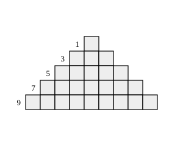
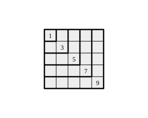

## Statement

Sur du papier quadrillé, on dessine la figure suivante : la ligne du haut compte un carreau, la deuxième ligne en compte trois, la troisième en compte cinq, et ainsi de suite. Chaque ligne est centrée sous la précédente.

Combien cette figure compte-t-elle de carreaux en tout si elle a :

1. $5$ lignes ;
2. $9$ lignes ;
3. $2016$ lignes ?

## Hints

1. Écris le nombre de carreaux de la première ligne, de la deuxième, de la troisième, de la quatrième. Quelle suite de nombres reconnais-tu ?
2. Fais l'addition pour $5$ lignes. Puis pour $9$ lignes. Regarde bien les deux résultats obtenus : ce sont des nombres que tu connais bien.
3. Pour additionner $1 + 3 + 5 + \dots + 17$ sans te tromper, tu n'es pas obligé d'aller de gauche à droite. Essaie de regrouper le premier terme avec le dernier, le deuxième avec l'avant-dernier, et ainsi de suite.
4. Pour $2016$ lignes, il faut comprendre pourquoi la réponse est toujours un carré. Dessine un carré de $5$ sur $5$ carreaux et découpe-le en équerres emboîtées, la plus petite en haut à gauche. Combien de carreaux dans chaque équerre ?

## Solution

**Étape 1. Combien de carreaux dans chaque ligne ?**

La ligne $1$ en a $1$, la ligne $2$ en a $3$, la ligne $3$ en a $5$, la ligne $4$ en a $7$. À chaque fois on ajoute $2$ carreaux : ce sont les **nombres impairs**, dans l'ordre.

La ligne numéro $k$ compte donc le $k$-ième nombre impair, c'est-à-dire $2k - 1$ carreaux.

Le nombre total de carreaux d'une figure à $n$ lignes est donc

$$1 + 3 + 5 + \dots + (2n - 1)$$

**Étape 2. Cinq lignes.**

$$1 + 3 + 5 + 7 + 9 = 25$$

On remarque que $25 = 5 \times 5$.

**Étape 3. Neuf lignes.**

Le neuvième nombre impair est $2 \times 9 - 1 = 17$. Il faut donc calculer

$$1 + 3 + 5 + 7 + 9 + 11 + 13 + 15 + 17$$

Plutôt que d'additionner dans l'ordre, regroupons le premier terme avec le dernier, le deuxième avec l'avant-dernier, et ainsi de suite :

$$(1 + 17) + (3 + 15) + (5 + 13) + (7 + 11) + 9 = 18 + 18 + 18 + 18 + 9 = 81$$

Et l'on remarque que $81 = 9 \times 9$.

**Étape 4. L'idée : découper un carré en équerres.**

Les deux résultats précédents donnent envie de dire que la figure à $n$ lignes contient $n \times n$ carreaux. Voici pourquoi c'est vrai.

Prenons un carré de $n$ sur $n$ carreaux, et découpons-le en **équerres** emboîtées, en partant du coin en haut à gauche.

- La première équerre est le seul carreau du coin : $1$ carreau.
- La deuxième équerre longe le carré de $2$ sur $2$ : elle a $1$ carreau en bas à droite, plus $1$ à sa gauche et $1$ au-dessus, soit $3$ carreaux.
- De façon générale, la $k$-ième équerre est formée d'un carreau d'angle, de $k - 1$ carreaux vers la gauche et de $k - 1$ carreaux vers le haut, soit

$$1 + (k-1) + (k-1) = 2k - 1 \text{ carreaux}$$

C'est exactement le nombre de carreaux de la $k$-ième ligne de notre figure.

Les $n$ équerres remplissent tout le carré sans se chevaucher. Donc

$$1 + 3 + 5 + \dots + (2n - 1) = n \times n$$

**Étape 5. Deux mille seize lignes.**

$$2016 \times 2016 = 4\,064\,256$$

**Conclusion.** La figure contient $25$ carreaux avec $5$ lignes, $81$ carreaux avec $9$ lignes, et $4\,064\,256$ carreaux avec $2016$ lignes. De façon générale, une figure à $n$ lignes contient $n^2$ carreaux.

## Going further

1. Combien de carreaux y a-t-il dans la centième ligne de cette figure ?
2. Une figure de ce type contient exactement $10\,000$ carreaux. Combien a-t-elle de lignes ?
3. En utilisant le résultat de l'exercice, calculer $51 + 53 + 55 + \dots + 99$ sans poser toutes les additions.
