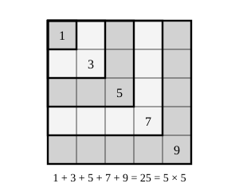

## Statement

Que vaut la somme des $n$ premiers nombres impairs ?

$$1 + 3 + 5 + \dots + (2n-1) = \ ?$$

Trouver la réponse, puis la démontrer.

## Hints

1. Calcule cette somme pour $n = 1$, puis $2$, puis $3$, puis $4$, puis $5$. Reconnais-tu les nombres que tu obtiens ?
2. Tu as dû trouver $n^2$. Il reste à comprendre pourquoi. Dessine un carré de $n$ sur $n$ petits carreaux : il en contient $n^2$.
3. Découpe ce carré en bandes en forme de L, emboîtées comme des équerres, en partant d'un coin. Combien de carreaux dans chaque bande ?
4. Autre méthode, sans dessin : suppose la formule connue pour un certain $n$, et combien de carreaux faut-il ajouter à un carré $n \times n$ pour obtenir un carré $(n+1) \times (n+1)$ ?

## Solution

### La réponse

Calculons les premières sommes :

$$1 = 1 \qquad 1+3 = 4 \qquad 1+3+5 = 9 \qquad 1+3+5+7 = 16 \qquad 1+3+5+7+9 = 25$$

On reconnaît $1$, $4$, $9$, $16$, $25$, c'est-à-dire $1^2$, $2^2$, $3^2$, $4^2$, $5^2$. On devine donc

$$1 + 3 + 5 + \dots + (2n-1) = n^2$$

Reste à le démontrer. Voici deux façons de le faire.

### Première démonstration : un découpage

*L'idée : un carré de côté $n$ se découpe en $n$ équerres, et ces équerres contiennent $1$, $3$, $5$, … carreaux.*

Prenons un carré de $n$ sur $n$ carreaux. Il contient $n^2$ carreaux.

Découpons-le en bandes en forme de L emboîtées, en partant d'un coin : le carreau du coin tout seul, puis l'équerre qui l'entoure, puis l'équerre suivante, et ainsi de suite.

Combien de carreaux dans la $k$-ième équerre ? Elle est formée d'une colonne de $k$ carreaux et d'une ligne de $k$ carreaux, qui se rejoignent sur un carreau commun, celui du coin. Elle contient donc

$$k + k - 1 = 2k - 1 \text{ carreaux}$$

C'est bien le $k$-ième nombre impair. Comme il y a $n$ équerres et qu'elles remplissent exactement le carré sans se chevaucher :

$$n^2 = 1 + 3 + 5 + \dots + (2n-1)$$

### Deuxième démonstration : de proche en proche

*L'idée : on ne démontre pas la formule d'un coup, on montre qu'elle se transmet de $n$ à $n+1$.*

**Le point de départ.** Pour $n = 1$, la somme vaut $1$ et $1^2 = 1$. La formule est vraie.

**Le passage de $n$ à $n+1$.** Supposons la formule vraie pour un certain nombre $n$, c'est-à-dire

$$1 + 3 + \dots + (2n-1) = n^2$$

Ajoutons des deux côtés le nombre impair suivant, qui est $2(n+1) - 1 = 2n+1$ :

$$1 + 3 + \dots + (2n-1) + (2n+1) = n^2 + 2n + 1$$

Or, en développant,

$$(n+1)^2 = (n+1)(n+1) = n \times n + n \times 1 + 1 \times n + 1 \times 1 = n^2 + 2n + 1$$

Les deux membres de droite sont égaux, donc

$$1 + 3 + \dots + (2n+1) = (n+1)^2$$

La formule est donc vraie pour $n+1$ aussi.

**Conclusion du raisonnement.** La formule est vraie pour $n = 1$ ; comme elle se transmet, elle est donc vraie pour $n = 2$, puis pour $n = 3$, et ainsi de suite sans jamais s'arrêter. Elle est vraie pour tout entier naturel $n \geqslant 1$.

**Réponse.** La somme des $n$ premiers nombres impairs vaut $n^2$.

## Going further

Le même raisonnement de proche en proche permet de démontrer une autre formule, où ce sont cette fois des puissances de $2$ qu'on additionne :

$$1 + 2 + 4 + 8 + \dots + 2^n = 2^{n+1} - 1$$

Pour $n = 0$ elle est vraie : $1 = 2^1 - 1$. Et si elle est vraie pour un certain $n$, ajoutons $2^{n+1}$ des deux côtés :

$$1 + 2 + \dots + 2^n + 2^{n+1} = 2^{n+1} - 1 + 2^{n+1} = 2 \times 2^{n+1} - 1 = 2^{n+2} - 1$$

C'est exactement la formule pour $n+1$.
