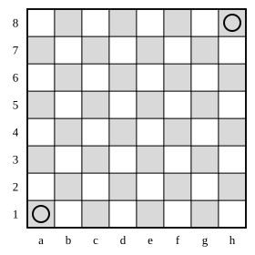

## Statement

Un échiquier est un damier de $8 \times 8$ cases, coloriées alternativement en clair et en foncé. Les colonnes sont désignées par les lettres $a$ à $h$, les lignes par les chiffres $1$ à $8$ : ainsi $a1$ est la case du coin en bas à gauche et $h8$ celle du coin en haut à droite.

Le cavalier se déplace en L : deux cases dans une direction, horizontale ou verticale, puis une case dans la direction perpendiculaire.

Un cavalier peut-il partir de la case $a1$, passer exactement une fois par chacune des $64$ cases de l'échiquier, et terminer son parcours sur la case $h8$ ?

## Hints

1. Combien de déplacements le cavalier doit-il faire en tout pour visiter les $64$ cases, une fois chacune ?
2. Surveille la couleur de la case où se trouve le cavalier. Que devient cette couleur après un déplacement ? Essaie sur un coin du damier.
3. De quelle couleur est la case $a1$ ? Et la case $h8$ ? Regarde la grande diagonale qui va de l'une à l'autre.
4. Après un nombre **impair** de changements de couleur, le cavalier est-il sur une case de la même couleur qu'au départ ?

## Solution

**Réponse : non, un tel parcours est impossible.**

**L'idée : le coloriage du damier. On surveille la couleur de la case occupée.**

**Étape 1. Compter les déplacements.**

Le cavalier doit occuper $64$ cases : la case de départ, puis une nouvelle case après chaque déplacement. Il lui faut donc

$$64 - 1 = 63 \text{ déplacements.}$$

Le nombre $63$ est impair : retenons-le.

**Étape 2. Un déplacement de cavalier change toujours la couleur de la case.**

Numérotons les colonnes de $1$ à $8$ (la colonne $a$ porte le numéro $1$, la colonne $h$ le numéro $8$), et les lignes de $1$ à $8$. Chaque case est repérée par deux nombres : son numéro de colonne $i$ et son numéro de ligne $j$.

Deux cases voisines par un côté ont une somme $i + j$ qui diffère de $1$. Comme les couleurs alternent elles aussi d'une case à sa voisine, la couleur d'une case ne dépend que de la parité de $i + j$ :

- $i + j$ pair : une couleur ;
- $i + j$ impair : l'autre couleur.

Voyons maintenant ce que fait un déplacement du cavalier. Il change $i$ de $1$ et $j$ de $2$, ou bien $i$ de $2$ et $j$ de $1$ (dans un sens ou dans l'autre). Dans tous les cas, la somme $i + j$ change de

$$1 + 2 = 3, \qquad \text{ou de} \qquad 2 - 1 = 1,$$

au signe près : le changement vaut $3$, $1$, $-1$ ou $-3$. C'est toujours un nombre **impair**.

Ajouter un nombre impair change la parité de $i + j$. Donc **à chaque déplacement, le cavalier change de couleur de case**.

**Étape 3. Où se trouve-t-on après $63$ déplacements ?**

Le cavalier change de couleur $63$ fois, c'est-à-dire un nombre impair de fois. Les couleurs s'alternent : après $1$ changement la couleur est différente du départ, après $2$ elle est la même, après $3$ elle est différente, et ainsi de suite. Après un nombre impair de changements, le cavalier est donc sur une case de la **couleur opposée** à celle de sa case de départ.

**Étape 4. Mais $a1$ et $h8$ ont la même couleur.**

Pour $a1$ : $i = 1$ et $j = 1$, donc $i + j = 2$, un nombre pair.
Pour $h8$ : $i = 8$ et $j = 8$, donc $i + j = 16$, un nombre pair lui aussi.

Les deux cases ont donc la même couleur. On peut aussi le voir directement sur le damier : $a1$ et $h8$ sont les deux bouts de la grande diagonale, et toutes les cases d'une même diagonale ont la même couleur.

**Conclusion.**

Le cavalier devrait finir sur une case de couleur opposée à $a1$, alors que $h8$ est de la même couleur que $a1$. C'est contradictoire : **un tel parcours n'existe pas.**

## Going further

1. Le même argument interdit-il un parcours qui part de $a1$, visite toutes les cases une fois et **revient** en $a1$ ?
2. Et un parcours de $a1$ à $b1$ passant une fois par chaque case : l'argument des couleurs l'interdit-il ?
3. Question concrète, sans parcourir tout le damier : quel est le plus petit nombre de déplacements dont un cavalier a besoin pour aller de $a1$ à $h8$ ?
