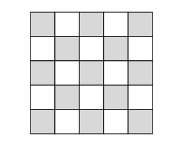

## Statement

Dans chaque case d'un carré $5 \times 5$ est posée une coccinelle : il y en a donc $25$ en tout, une par case.

Soudain, toutes les coccinelles s'affolent en même temps, et chacune passe dans une case voisine, c'est-à-dire une case qui partage un côté avec la sienne.

Est-il possible qu'après ce remue-ménage il y ait de nouveau exactement une coccinelle par case ?

## Hints

1. Essaie d'abord la même question sur un carré $2 \times 2$, puis sur un carré $3 \times 3$. Dans quel cas y arrives-tu ?
2. Colorie le carré $5 \times 5$ comme un échiquier. Compte les cases de chaque couleur : y en a-t-il autant ?
3. Quand une coccinelle passe dans une case voisine, que devient la couleur de la case sur laquelle elle se trouve ?

## Solution

**Réponse : non, c'est impossible.**

**L'idée : on colorie le carré comme un échiquier.**

Colorions le carré $5 \times 5$ en alternant deux couleurs, de sorte que deux cases voisines soient toujours de couleurs différentes.

**Étape 1. Les deux couleurs ne sont pas en nombre égal.**

Comptons ligne par ligne, en commençant par une case grise dans le coin en haut à gauche :

- les lignes $1$, $3$ et $5$ contiennent $3$ cases grises et $2$ blanches ;
- les lignes $2$ et $4$ contiennent $2$ cases grises et $3$ blanches.

Au total : $3 \times 3 + 2 \times 2 = 13$ cases grises, et $3 \times 2 + 2 \times 3 = 12$ cases blanches. On vérifie que $13 + 12 = 25$.

C'est le point important : **il y a une case grise de plus que de cases blanches.** Cela vient du fait que $5$ est impair.

**Étape 2. Chaque coccinelle change de couleur.**

Deux cases voisines sont de couleurs différentes. Donc une coccinelle qui part d'une case grise arrive sur une case blanche, et une coccinelle qui part d'une case blanche arrive sur une case grise.

**Étape 3. La contradiction.**

Au départ, $13$ coccinelles sont posées sur les $13$ cases grises. D'après l'étape 2, ces $13$ coccinelles se retrouvent toutes sur des cases blanches.

Or il n'y a que $12$ cases blanches. Si on veut au final **une seule** coccinelle par case, les cases blanches ne peuvent accueillir que $12$ coccinelles au total. Impossible d'y en loger $13$ : au moins deux d'entre elles atterrissent forcément dans la même case.

**Conclusion.** Après le remue-ménage, il y aura forcément une case avec au moins deux coccinelles (et donc aussi une case vide). Il est impossible de retrouver exactement une coccinelle par case.

*Ce qu'il faut retenir.* Le coloriage en échiquier transforme un problème de déplacement en un problème de comptage : il suffit alors de comparer deux nombres.

## Going further

1. Reprendre la question avec un carré $4 \times 4$. Cette fois, c'est possible : trouver un déplacement qui convient.
2. Pour quelles valeurs de $n$ le remue-ménage est-il possible dans un carré $n \times n$ ? Démontrer la réponse dans les deux sens : montrer que c'est impossible dans un cas, et donner une méthode générale dans l'autre.
3. Même question dans un carré $5 \times 5$, mais les coccinelles ont le droit de passer aussi dans une case voisine **en diagonale**. Que devient la réponse ?
