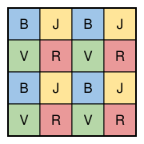

## Statement

Soit $n \geqslant 2$ un entier. On pose une pièce sur chaque case d'un échiquier de $n \times n$
cases.

Un **mouvement** consiste à déplacer **toutes** les pièces en même temps : chaque pièce va sur une
case qui touche la sienne par un coin, et seulement par un coin. Autrement dit, chaque pièce avance
d'une case en diagonale, dans la direction qu'on veut, sans sortir de l'échiquier. Plusieurs pièces
peuvent se retrouver sur la même case.

Quel est le plus petit entier $k$ pour lequel il est possible qu'après un certain nombre de
mouvements, seulement $k$ cases contiennent au moins une pièce ?

## Hints

1. Essaie avec $n = 2$, puis avec $n = 3$. Peut-on réunir toutes les pièces sur une seule case ?
   Sur deux cases ?
2. Numérote les lignes et les colonnes. Quand une pièce fait un mouvement, que deviennent son numéro
   de ligne et son numéro de colonne ? Et leur parité ?
3. Colorie chaque case selon que son numéro de ligne est pair ou impair, et selon que son numéro de
   colonne est pair ou impair. Cela fait quatre couleurs. Que devient la couleur d'une pièce à chaque
   mouvement ?
4. Pour réunir les pièces, on peut s'occuper séparément des lignes et des colonnes : tant que le
   numéro de ligne d'une pièce dépasse $2$, on peut le faire baisser de $1$.

## Solution

Numérotons les lignes de $1$ à $n$ de haut en bas, et les colonnes de $1$ à $n$ de gauche à droite.
La case de la ligne $\ell$ et de la colonne $c$ est notée $(\ell, c)$. Les cases qui touchent
$(\ell, c)$ par un coin seulement sont les cases $(\ell \pm 1, c \pm 1)$. Ainsi, à chaque mouvement,
le numéro de ligne d'une pièce change de $1$ (il monte ou il descend), et son numéro de colonne
change aussi de $1$, les deux choix étant libres du moment que la pièce reste sur l'échiquier.

La réponse est $k = 4$.

**Étape 1. On peut réunir toutes les pièces sur $4$ cases.** Voici une règle pour transformer un
numéro $x$ compris entre $1$ et $n$ :

- si $x \geqslant 2$, on le remplace par $x - 1$ ;
- si $x = 1$, on le remplace par $2$ (c'est possible car $n \geqslant 2$).

À chaque mouvement, chaque pièce applique cette règle à son numéro de ligne et à son numéro de
colonne. Les deux numéros changent de $1$ et restent entre $1$ et $n$, donc la pièce avance bien en
diagonale sans sortir de l'échiquier.

Suivons un numéro $x$. Tant qu'il vaut au moins $3$, il baisse de $1$ à chaque mouvement. Une fois
qu'il vaut $1$ ou $2$, il passe de $2$ à $1$ puis de $1$ à $2$, et ainsi de suite : il reste égal à
$1$ ou à $2$. Comme $x \leqslant n$, il lui faut au plus $n - 2$ mouvements pour arriver à $1$ ou
à $2$.

Après $n$ mouvements, toutes les pièces ont donc un numéro de ligne et un numéro de colonne égaux à
$1$ ou à $2$ : elles sont toutes dans le carré de $2 \times 2$ cases situé en haut à gauche. Au plus
$4$ cases contiennent une pièce.

**Étape 2. Il reste toujours au moins $4$ cases occupées.** Colorions l'échiquier avec quatre
couleurs, selon la parité des numéros :

| | colonne impaire | colonne paire |
|---|---|---|
| **ligne impaire** | bleu (B) | jaune (J) |
| **ligne paire** | vert (V) | rouge (R) |

Voici ce coloriage pour $n = 4$ :

À chaque mouvement, le numéro de ligne et le numéro de colonne changent de $1$, donc **les deux
parités changent**. Une pièce sur une case bleue (ligne impaire, colonne impaire) arrive sur une case
de ligne paire et de colonne paire, donc rouge. De même, une pièce passe du rouge au bleu, du jaune
au vert et du vert au jaune.

Rangeons maintenant les pièces en quatre groupes, selon la couleur de leur case **au départ**.
Comme $n \geqslant 2$, les cases $(1, 1)$, $(1, 2)$, $(2, 1)$ et $(2, 2)$ existent, donc chacun des
quatre groupes contient au moins une pièce.

Après un nombre **pair** de mouvements, chaque pièce est revenue sur la couleur de son départ : les
pièces du groupe bleu sont sur des cases bleues, celles du groupe jaune sur des cases jaunes, et
ainsi de suite. Après un nombre **impair** de mouvements, les pièces du groupe bleu sont sur des
cases rouges, celles du groupe rouge sur des cases bleues, celles du groupe jaune sur des cases
vertes et celles du groupe vert sur des cases jaunes.

Dans les deux cas, à tout moment, il y a au moins une pièce sur une case de chacune des quatre
couleurs. Ces quatre cases sont différentes, donc au moins $4$ cases contiennent une pièce.

**Conclusion : le plus petit $k$ possible est $k = 4$, quel que soit $n \geqslant 2$.**

## Going further

Que se passe-t-il si, à chaque mouvement, chaque pièce va plutôt sur une case qui touche la sienne
**par un côté** ? Cette fois, à chaque mouvement, un seul des deux numéros change de $1$. Le
coloriage habituel de l'échiquier, en noir et blanc, montre qu'il reste toujours au moins $2$ cases
occupées : les pièces parties des cases noires et celles parties des cases blanches échangent leurs
couleurs à chaque mouvement. Et on peut réunir toutes les pièces sur les $2$ premières cases de la
première ligne : chaque pièce monte tant qu'elle n'est pas sur la ligne $1$, puis va vers la gauche
tant qu'elle n'est pas dans les colonnes $1$ et $2$, puis fait des allers-retours entre ces deux
cases.
