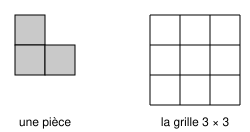
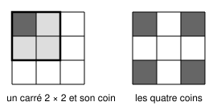

## Statement

Gabrielle dispose d'une grille $3 \times 3$ et de pièces en forme de $L$ recouvrant chacune trois cases, comme ci-dessous. Elle peut tourner ses pièces comme elle veut, mais les pièces ne doivent ni se chevaucher ni dépasser de la grille.

Peut-elle recouvrir entièrement sa grille avec de telles pièces ?

## Hints

1. Commence par compter : combien de pièces lui faudrait-il exactement ?
2. Essaie à la main quelques placements. Tu verras vite que ça coince, mais un essai raté ne démontre rien : il faut un argument qui vaut pour **tous** les placements.
3. Une pièce en $L$ tient toujours dans un carré $2 \times 2$. Combien de carrés $2 \times 2$ y a-t-il dans une grille $3 \times 3$ ?
4. Repère quatre cases telles qu'aucune pièce ne puisse en couvrir deux à la fois.

## Solution

**Le compte des pièces.** La grille a $3 \times 3 = 9$ cases, et chaque pièce en couvre $3$. Si Gabrielle réussissait, elle utiliserait donc exactement $9 \div 3 = 3$ pièces.

**Les quatre coins.** Considérons les quatre cases situées aux **coins** de la grille.

*Affirmation : une pièce en $L$ ne peut jamais couvrir deux coins à la fois.*

En effet, une pièce en $L$, quelle que soit son orientation, est toujours contenue dans un carré $2 \times 2$ : c'est un carré $2 \times 2$ auquel il manque une case. Or dans une grille $3 \times 3$, il n'y a que quatre carrés $2 \times 2$ possibles (en haut à gauche, en haut à droite, en bas à gauche, en bas à droite), et **chacun d'eux ne contient qu'un seul coin de la grille**.

Donc chaque pièce couvre au plus un coin.

**La contradiction.** Avec $3$ pièces, Gabrielle couvrirait au plus $3$ coins. Or la grille en a $4$, et un recouvrement complet doit tous les couvrir.

**Conclusion.** Gabrielle ne peut pas recouvrir sa grille $3 \times 3$ avec des pièces en $L$.

## Going further

L'idée à retenir : quand des pièces sont contraintes par leur forme, il est souvent plus efficace de repérer quelques cases « difficiles à atteindre ensemble » que de colorier toute la grille.

Et pour d'autres tailles ? On peut démontrer qu'un rectangle $a \times b$ peut être pavé par des pièces en $L$ exactement lorsque $3$ divise $ab$, sauf dans deux familles d'exceptions : quand le plus petit des deux côtés vaut $1$, et quand le plus petit vaut $3$ et que $ab$ est impair. Notre grille $3 \times 3$ relève justement de cette seconde exception.
