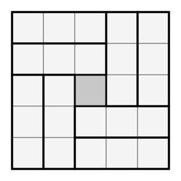
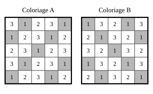

## Statement

Dans un carré de $5 \times 5$ cases, on place $8$ rectangles de $1 \times 3$ cases. Les rectangles suivent le quadrillage, ne se chevauchent pas et ne dépassent pas du carré. Chacun peut être posé couché ou debout.

Comme $8 \times 3 = 24$ et que le carré compte $25$ cases, il reste exactement **une case libre**.

Quelles cases peuvent rester libres ? Les trouver toutes.

## Hints

1. Il y a deux choses à faire, et il faut les deux : montrer qu'une certaine case **peut** rester libre, en dessinant un placement qui marche, et montrer qu'aucune autre case ne le peut.
2. Pour l'exemple, essaie de laisser libre la case du centre. Une idée : découpe le carré privé du centre en quatre rectangles $2 \times 3$ disposés en moulin, puis coupe chacun en deux.
3. Pour éliminer les autres cases, colorie le carré en $3$ couleurs, en suivant les diagonales. Compte combien de cases reçoivent chaque couleur : les trois nombres ne sont pas égaux.
4. Combien de cases de chaque couleur un rectangle $1 \times 3$ recouvre-t-il ? Regarde les trois cases qu'il occupe, couché puis debout.
5. Tu obtiens une liste de $9$ cases possibles. Recommence tout avec le coloriage diagonal penché dans **l'autre sens**. Quelles cases figurent dans les deux listes ?

## Solution

Il faut répondre à deux questions bien différentes : **quelle case peut** rester libre, et **quelles cases ne peuvent pas**. On traite les deux séparément.

### Partie 1. Le centre peut rester libre

Voici un placement des $8$ rectangles qui laisse la case centrale libre.

Pour le retrouver soi-même : le carré privé de sa case centrale se découpe en quatre rectangles $2 \times 3$ disposés en moulin, c'est-à-dire tournant autour du centre. Chaque rectangle $2 \times 3$ se coupe ensuite en deux rectangles $1 \times 3$, ce qui donne bien $4 \times 2 = 8$ rectangles.

Le centre est donc **une** réponse possible. Reste à voir s'il y en a d'autres.

### Partie 2. Aucune autre case ne peut rester libre

**L'idée : colorier en trois couleurs le long des diagonales.**

Numérotons les lignes et les colonnes de $1$ à $5$. Pour la case située à la ligne $i$ et la colonne $j$, calculons le reste de $i+j$ dans la division par $3$, et donnons-lui la couleur $1$, $2$ ou $3$ selon que ce reste vaut $0$, $1$ ou $2$. Les cases d'une même couleur forment des diagonales parallèles : c'est le **coloriage A** de la figure ci-dessous.

**Les trois couleurs ne sont pas en nombre égal.** En comptant sur la figure :

$$\text{couleur } 1 : 9 \text{ cases}, \qquad \text{couleur } 2 : 8 \text{ cases}, \qquad \text{couleur } 3 : 8 \text{ cases}$$

On vérifie : $9 + 8 + 8 = 25$.

**Chaque rectangle recouvre une case de chaque couleur.**

Un rectangle couché occupe les cases $(i,\,j)$, $(i,\,j+1)$ et $(i,\,j+2)$. Les trois sommes

$$i+j, \qquad i+j+1, \qquad i+j+2$$

sont trois nombres qui se suivent. Or, parmi trois nombres qui se suivent, les restes dans la division par $3$ sont toujours $0$, $1$ et $2$, chacun une fois. Le rectangle recouvre donc exactement une case de chaque couleur.

Pour un rectangle debout, il occupe $(i,\,j)$, $(i+1,\,j)$ et $(i+2,\,j)$, et les sommes sont encore trois nombres qui se suivent. Même conclusion.

**On compte.** Les $8$ rectangles recouvrent donc $8$ cases de la couleur $1$, $8$ de la couleur $2$ et $8$ de la couleur $3$.

Les couleurs $2$ et $3$ ne comptent que $8$ cases chacune : elles sont **entièrement recouvertes**. La couleur $1$ en compte $9$ : il en reste une.

**La case libre est donc de couleur $1$**, c'est-à-dire l'une des $9$ cases grisées du coloriage A.

**On recommence en penchant les diagonales dans l'autre sens.**

Rien ne nous obligeait à choisir ce coloriage-là. Faisons exactement le même raisonnement avec le reste de $i-j$ dans la division par $3$ : c'est le **coloriage B** de la figure, l'image de A dans un quart de tour. Les comptes sont les mêmes : $9$, $8$, $8$ cases. Et un rectangle $1 \times 3$ recouvre là encore une case de chaque couleur, car les trois différences $i-j$, $i-j-1$, $i-j-2$ (rectangle couché) ou $i-j$, $i-j+1$, $i-j+2$ (rectangle debout) sont trois nombres qui se suivent.

Donc la case libre est aussi l'une des $9$ cases grisées du coloriage B.

**On croise les deux listes.** La case libre doit être grisée dans A **et** dans B. En regardant la figure, une seule case l'est dans les deux : la case centrale.

On peut aussi le voir par le calcul : il faut que $i+j$ et $i-j$ soient tous deux des multiples de $3$. Leur somme $2i$ et leur différence $2j$ le sont alors aussi, donc $i$ et $j$ sont des multiples de $3$. Entre $1$ et $5$, le seul multiple de $3$ est $3$ : la case est celle de la ligne $3$ et de la colonne $3$, le centre.

**Conclusion.** La seule case qui peut rester libre est la case centrale. La partie 1 montre qu'elle le peut effectivement.

## Going further

1. Combien de placements différents des $8$ rectangles laissent le centre libre ? Le moulin peut tourner dans deux sens : cela suffit-il à les compter tous ?
2. Dans un carré $4 \times 4$, on place $5$ rectangles $1 \times 3$. Une case reste libre. Quelles cases sont possibles ? Le même coloriage sert-il ?
3. Pourquoi le coloriage en $3$ couleurs par colonnes (toute la colonne $1$ en couleur $1$, la colonne $2$ en couleur $2$, etc.) ne donne-t-il rien d'utile ici ?
