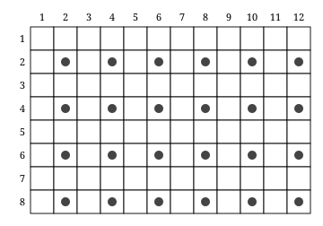
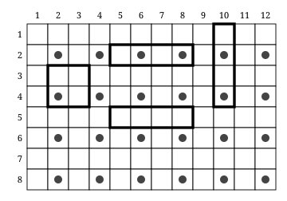

## Statement

Un sol rectangulaire est entièrement recouvert de carreaux de deux sortes : des carreaux carrés de $2 \times 2$ et des carreaux en bande de $1 \times 4$.

Un carreau s'est cassé. Pour le remplacer, on ne dispose que d'un carreau de **l'autre** sorte.

Montrer qu'il est alors impossible de recouvrir le sol, même en réarrangeant complètement le carrelage.

## Hints

1. Commence par le compte des carreaux. Tous les carreaux, des deux sortes, recouvrent $4$ cases. Le nouveau carrelage aura donc autant de carreaux que l'ancien : simplement, un carreau $2 \times 2$ en moins et un $1 \times 4$ en plus, ou l'inverse.
2. Essayer des carrelages au hasard ne prouvera jamais rien. Il faut trouver une quantité qui **ne change jamais**, quel que soit le carrelage.
3. Numérote les lignes et les colonnes du sol, et marque d'un point les cases dont le numéro de ligne **et** le numéro de colonne sont tous les deux pairs.
4. Pose un carreau $2 \times 2$ n'importe où : combien de cases marquées recouvre-t-il ? Essaie plusieurs positions.
5. Même question pour un carreau $1 \times 4$, couché puis debout. Regarde la parité des deux réponses.

## Solution

**Étape 1. Le compte des carreaux ne donne rien.**

Chaque carreau, quelle que soit sa sorte, recouvre $4$ cases. Si le sol compte $N$ cases, tout carrelage utilise exactement $\dfrac{N}{4}$ carreaux. Le nouveau carrelage aura donc le même nombre total de carreaux que l'ancien : un carreau $2 \times 2$ de moins et un carreau $1 \times 4$ de plus, ou bien l'inverse.

Le compte tombe juste. L'obstacle est ailleurs.

**Étape 2. L'idée : marquer certaines cases.**

Découpons le sol en cases de la taille d'un petit carré de carreau, et numérotons les lignes $1, 2, 3, \ldots$ de haut en bas et les colonnes $1, 2, 3, \ldots$ de gauche à droite.

**Marquons d'un point les cases dont le numéro de ligne et le numéro de colonne sont tous les deux pairs.**

Les cases marquées forment un quadrillage plus lâche : une case sur deux, une ligne sur deux.

**Étape 3. Ce que recouvre chaque sorte de carreau.**

*Un carreau $2 \times 2$.* Il occupe deux lignes qui se suivent : exactement une des deux porte un numéro pair. Il occupe de même deux colonnes qui se suivent, dont exactement une porte un numéro pair. La case marquée est celle qui se trouve à la fois sur cette ligne et sur cette colonne : **un carreau $2 \times 2$ recouvre toujours exactement $1$ case marquée**, où qu'on le pose.

*Un carreau $1 \times 4$ couché.* Il occupe une seule ligne et quatre colonnes qui se suivent. Parmi quatre numéros qui se suivent, il y en a exactement deux pairs. Donc :

- si sa ligne porte un numéro pair, il recouvre $2$ cases marquées ;
- si sa ligne porte un numéro impair, il n'en recouvre aucune.

*Un carreau $1 \times 4$ debout.* Le même raisonnement, en échangeant les rôles des lignes et des colonnes, donne $2$ ou $0$.

Dans tous les cas, **un carreau $1 \times 4$ recouvre un nombre pair de cases marquées.**

**Étape 4. L'invariant.**

Prenons un carrelage quelconque du sol, avec $k$ carreaux $2 \times 2$. Comptons les cases marquées en additionnant, carreau par carreau, celles qu'il recouvre :
$$(\text{nombre de cases marquées du sol}) = \underbrace{k \times 1}_{\text{carreaux } 2 \times 2} + \underbrace{(\text{un nombre pair})}_{\text{carreaux } 1 \times 4}.$$

Le nombre de cases marquées du sol ne dépend que du sol, pas du carrelage. Donc **$k$ a toujours la même parité, quel que soit le carrelage** : $k$ est pair pour tous les carrelages de ce sol, ou impair pour tous.

**Étape 5. La contradiction.**

Le carrelage d'origine contient un certain nombre $k$ de carreaux $2 \times 2$. Le nouveau carrelage en contiendrait :

- $k - 1$, si c'est un carreau $2 \times 2$ qui s'est cassé et qu'on le remplace par un $1 \times 4$ ;
- $k + 1$, si c'est un carreau $1 \times 4$ qui s'est cassé et qu'on le remplace par un $2 \times 2$.

Dans les deux cas, le nombre de carreaux $2 \times 2$ change de parité. C'est impossible d'après l'étape 4.

**Conclusion.** On ne peut pas recarreler le sol avec un carreau d'une sorte en moins et un carreau de l'autre sorte en plus, quelle que soit la façon de s'y prendre.

## Going further

1. Vérifie l'invariant à la main sur un sol $4 \times 4$ : trouve plusieurs carrelages et compte à chaque fois les carreaux $2 \times 2$. Que constates-tu ?
2. Un sol $6 \times 6$ peut-il être recouvert uniquement avec des carreaux $1 \times 4$ ? Combien de cases marquées un tel carrelage recouvrirait-il ?
