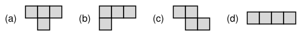

## Statement

On considère une grille carrée de $10 \times 10$ cases. Voici quatre pièces, chacune formée de $4$ cases :

Pour chacune de ces quatre pièces, dire si l'on peut recouvrir toute la grille avec des exemplaires de cette seule pièce, sans qu'ils se chevauchent ni dépassent de la grille. Chaque pièce recouvre exactement $4$ cases de la grille. On a le droit de tourner les pièces, mais pas de les retourner.

## Hints

1. Combien de pièces faudrait-il ? Pour montrer qu'un pavage est impossible, on peut colorier la grille et compter les cases de chaque couleur.
2. Pour (a), coloriez la grille en damier. Combien de cases noires une pièce en T recouvre-t-elle ?
3. Pour (b), essayez plutôt des colonnes alternativement noires et blanches.
4. Pour (c), regardez la case du coin en bas à gauche. De combien de façons une pièce peut-elle la recouvrir ? Et ensuite, la case juste à sa droite ?
5. Pour (d), coloriez en damier, mais avec des carrés de $2 \times 2$ cases à la place des cases simples.

## Solution

La grille a $100$ cases. Un pavage utiliserait donc exactement $100 \div 4 = 25$ pièces. On va voir que **c'est impossible pour chacune des quatre pièces**.

**(a) La pièce en T.** Colorions la grille en damier : $50$ cases noires et $50$ cases blanches. Quelle que soit sa position, une pièce en T recouvre $3$ cases d'une couleur et $1$ case de l'autre : la case du milieu a une couleur, ses trois voisines ont l'autre couleur.

Supposons qu'un pavage existe. Notons $k$ le nombre de pièces qui recouvrent $3$ cases noires. Les $25 - k$ autres recouvrent $1$ case noire. Le nombre de cases noires recouvertes vaut alors

$$3k + (25 - k) = 2k + 25.$$

Ce nombre est impair, alors qu'il devrait valoir $50$. C'est impossible.

**(b) La pièce en L.** Colorions les colonnes de la grille alternativement en noir et en blanc. Il y a encore $50$ cases noires et $50$ cases blanches. Regardons une pièce en L :

- si sa barre de trois cases est verticale, ces trois cases sont dans la même colonne, donc de la même couleur, et la quatrième case est dans la colonne voisine, de l'autre couleur ;
- si sa barre de trois cases est horizontale, ses couleurs alternent : noir, blanc, noir, ou blanc, noir, blanc. La quatrième case est dans la même colonne qu'une extrémité de la barre, donc de la même couleur que les deux extrémités.

Dans tous les cas, la pièce recouvre $3$ cases d'une couleur et $1$ de l'autre. Le même calcul qu'en (a) donne un nombre impair de cases noires recouvertes, au lieu de $50$. C'est impossible.

**(c) La pièce en Z.** Numérotons les colonnes de $1$ à $10$ de gauche à droite et les lignes de $1$ à $10$ de bas en haut. On note $(c\,;\,\ell)$ la case de la colonne $c$ et de la ligne $\ell$.

Une pièce en Z, qu'on peut seulement tourner, a deux positions possibles :

- couchée, comme sur la figure : deux cases côte à côte en haut, et deux cases en bas décalées d'une case vers la droite ;
- debout : deux cases l'une sur l'autre à gauche, et deux cases l'une sur l'autre à droite, décalées d'une case vers le haut.

Regardons la case du coin $(1\,;\,1)$.

- Une pièce couchée ne peut pas la recouvrir. Si c'est une de ses cases du haut, ses cases du bas tombent sous la grille. Si c'est une de ses cases du bas, sa case en haut à gauche tombe à gauche de la grille.
- Une pièce debout ne peut la recouvrir qu'avec sa case en bas à gauche, sinon une autre case sort de la grille. Cette pièce occupe alors $(1\,;\,1)$, $(1\,;\,2)$, $(2\,;\,2)$ et $(2\,;\,3)$.

Il faut maintenant recouvrir la case $(2\,;\,1)$, juste à droite du coin.

- Avec une pièce couchée, cette case doit faire partie des deux cases du bas, puisqu'il n'y a pas de ligne en dessous. Si c'est la case de droite, la case en haut à gauche de la pièce est $(0\,;\,2)$, hors de la grille. Si c'est la case de gauche, la pièce recouvre aussi $(1\,;\,2)$ et $(2\,;\,2)$, déjà occupées.
- Avec une pièce debout, la case $(2\,;\,1)$ doit être la case la plus basse de la pièce, c'est-à-dire sa case en bas à gauche. La pièce recouvre alors aussi $(2\,;\,2)$, déjà occupée.

La case $(2\,;\,1)$ ne peut donc pas être recouverte. C'est impossible.

**(d) La barre de quatre cases.** Découpons la grille en $25$ carrés de $2 \times 2$ cases, et colorions ces carrés en damier. Il y a $13$ carrés noirs et $12$ carrés blancs, donc $13 \times 4 = 52$ cases noires et $12 \times 4 = 48$ cases blanches.

Dans une ligne de la grille, les couleurs vont par paires : deux noires, deux blanches, deux noires, et ainsi de suite (ou en commençant par le blanc). C'est pareil dans une colonne. Une barre horizontale recouvre $4$ cases qui se suivent dans une ligne :

- si elle commence au début d'une paire, elle recouvre deux paires entières, l'une noire et l'autre blanche ;
- sinon, elle recouvre une case, puis une paire entière, puis une case. Les deux cases isolées ont la même couleur, et la paire du milieu a l'autre couleur.

Dans les deux cas, la barre recouvre $2$ cases noires et $2$ cases blanches. C'est pareil pour une barre verticale. Les $25$ barres recouvriraient donc $50$ cases noires, alors que la grille en a $52$. C'est impossible.

**Conclusion.** Aucune des quatre pièces ne permet de recouvrir la grille $10 \times 10$.

## Going further

1. Montrer qu'on peut recouvrir une grille $4 \times 4$ avec des pièces en T. Pourquoi l'argument du damier de la question (a) ne l'empêche-t-il pas ?
2. Et si l'on a le droit de retourner la pièce en Z, c'est-à-dire d'utiliser aussi son image dans un miroir ? Peut-on alors recouvrir la grille $10 \times 10$ ? Et un rectangle quelconque ?
