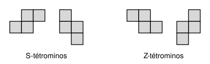
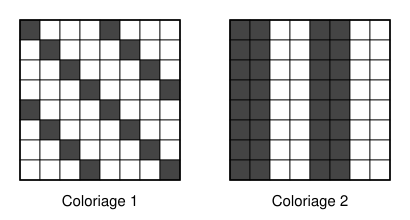

## Statement

On considère les quatre types de pièces suivants, formés chacun de quatre cases. Les deux premiers sont des S-tétrominos, les deux derniers des Z-tétrominos. On ne retourne pas les pièces : un S reste un S.

On choisit un ensemble de cases d'un échiquier $n \times n$ qui peut être pavé, sans trou ni chevauchement, uniquement avec des S-tétrominos.

Montrer que si l'on pave ce même ensemble de cases avec des S-tétrominos et des Z-tétrominos, de n'importe quelle manière, le nombre de Z-tétrominos utilisés est toujours pair.

## Hints

1. Il s'agit de trouver une quantité qui ne dépend que de l'ensemble de cases, et pas du pavage. Pense à colorier certaines cases en noir et à compter les cases noires recouvertes par chaque pièce.
2. Numérote les lignes et les colonnes. Colorie en noir une diagonale sur quatre : les cases où « numéro de ligne moins numéro de colonne » est un multiple de $4$. Combien de cases noires recouvre chacune des quatre pièces ?
3. Essaie aussi un coloriage en bandes verticales : deux colonnes noires, deux colonnes blanches, deux noires, et ainsi de suite.
4. Chacun des deux coloriages donne la parité d'une somme de deux nombres de pièces. Additionne les deux.

## Solution

On numérote les lignes de l'échiquier $0, 1, 2, \ldots$ de haut en bas, et les colonnes $0, 1, 2, \ldots$ de gauche à droite. La case de la ligne $\ell$ et de la colonne $k$ est notée $(\ell, k)$.

Dans un pavage, on note $s_h$ et $s_v$ les nombres de S couchés et debout, et $z_h$ et $z_v$ les nombres de Z couchés et debout. Si une pièce a sa case en haut à gauche de son cadre en $(\ell, k)$, elle recouvre les cases suivantes.

| Pièce | Cases recouvertes |
|---|---|
| S couché | $(\ell, k+1)$, $(\ell, k+2)$, $(\ell+1, k)$, $(\ell+1, k+1)$ |
| S debout | $(\ell, k)$, $(\ell+1, k)$, $(\ell+1, k+1)$, $(\ell+2, k+1)$ |
| Z couché | $(\ell, k)$, $(\ell, k+1)$, $(\ell+1, k+1)$, $(\ell+1, k+2)$ |
| Z debout | $(\ell, k+1)$, $(\ell+1, k+1)$, $(\ell+1, k)$, $(\ell+2, k)$ |

On utilise deux coloriages de l'échiquier.

**Coloriage 1 : une diagonale sur quatre.** La case $(\ell, k)$ est noire quand $\ell - k$ est un multiple de $4$. Posons $m = \ell - k$ et calculons $\ell - k$ pour les quatre cases de chaque pièce.

- S couché : $m - 1$, $m - 2$, $m + 1$, $m$. Ce sont quatre entiers consécutifs, et exactement l'un d'eux est un multiple de $4$. La pièce recouvre exactement $1$ case noire.
- Z debout : $m - 1$, $m$, $m + 1$, $m + 2$. Là encore quatre entiers consécutifs : exactement $1$ case noire.
- S debout : $m$, $m + 1$, $m$, $m + 1$. Chaque valeur apparaît deux fois : la pièce recouvre $0$ ou $2$ cases noires.
- Z couché : $m$, $m - 1$, $m$, $m - 1$. De même, $0$ ou $2$ cases noires.

Soit $N_1$ le nombre de cases noires de l'ensemble pour ce coloriage. Les pièces qui recouvrent un nombre pair de cases noires ne changent pas la parité du total. Donc $N_1$ a la même parité que $s_h + z_v$.

**Coloriage 2 : des bandes verticales.** La colonne $k$ est noire quand le reste de $k$ dans la division par $4$ vaut $0$ ou $1$ : deux colonnes noires, deux blanches, deux noires, et ainsi de suite. Deux colonnes séparées par une seule autre, comme les colonnes $k$ et $k + 2$, sont toujours de couleurs différentes.

- S couché : il occupe une case de la colonne $k$, deux cases de la colonne $k + 1$ et une case de la colonne $k + 2$. Les deux cases des colonnes $k$ et $k + 2$ donnent exactement $1$ case noire, et les deux cases de la colonne $k + 1$ en donnent $0$ ou $2$. Le total est impair.
- Z couché : de même, une case en colonne $k$, deux en colonne $k + 1$, une en colonne $k + 2$. Le total est impair.
- S debout et Z debout : deux cases dans une colonne et deux cases dans la colonne voisine. Chaque colonne donne $0$ ou $2$ cases noires, donc le total est pair.

Soit $N_2$ le nombre de cases noires de l'ensemble pour ce coloriage. Un nombre impair change la parité du total, un nombre pair ne la change pas. Donc $N_2$ a la même parité que $s_h + z_h$.

**Conclusion.** En ajoutant, $N_1 + N_2$ a la même parité que

$$s_h + z_v + s_h + z_h = 2\,s_h + (z_h + z_v).$$

Comme $2\,s_h$ est pair, $N_1 + N_2$ a la même parité que $z_h + z_v$, qui est le nombre total de Z-tétrominos.

Or $N_1 + N_2$ ne dépend que de l'ensemble de cases, et pas de la façon de le paver. Pour le pavage qui n'utilise que des S-tétrominos, le nombre de Z est $0$, donc $N_1 + N_2$ est pair. Par conséquent, dans n'importe quel pavage de cet ensemble par des S et des Z, le nombre de Z-tétrominos est pair.

## Going further

Aucun des deux coloriages ne suffit seul : le premier ne voit que les Z debout, le second que les Z couchés, et chacun est perturbé par les S couchés. C'est en les additionnant que les S couchés disparaissent, puisqu'ils sont comptés deux fois.

L'hypothèse « l'ensemble peut être pavé uniquement avec des S » est indispensable. Un S couché posé sur les lignes $0$ et $1$, et un Z couché posé juste en dessous sur les lignes $2$ et $3$, forment ensemble un ensemble de $8$ cases pavé avec un seul Z. D'après l'exercice, cet ensemble ne peut donc pas être pavé avec des S seulement. Vérifie-le directement.
