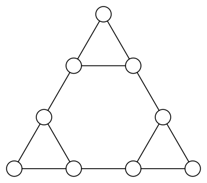
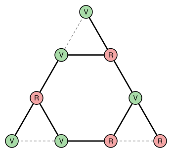

## Statement

La figure ci-dessous contient $9$ cercles. Deux cercles sont dits **reliés** s'il y a un segment entre eux qui ne passe par aucun autre cercle.

Eva colorie chaque cercle en vert ou en rouge. Une fois tous les cercles coloriés, elle gagne un bonbon pour chaque paire de cercles reliés qui sont de couleurs différentes.

Quel est le plus grand nombre de bonbons qu'Eva peut gagner ?

## Hints

1. Compte les segments de la figure. Eva peut-elle gagner un bonbon pour chacun d'eux ?
2. Regarde le petit triangle tout en haut : trois cercles, reliés deux à deux. Avec seulement deux couleurs, que se passe-t-il ?
3. Il y a trois petits triangles comme celui-là, et ils n'ont aucun segment en commun.
4. Pour trouver un bon coloriage, regarde les six cercles qui ne sont pas aux sommets du grand triangle : ils forment un hexagone.

## Solution

La réponse est $9$ bonbons. Pour le prouver, il faut deux choses : montrer qu'Eva ne peut jamais en gagner plus de $9$, puis donner un coloriage qui en rapporte exactement $9$.

**Les segments.** En comptant, la figure contient $12$ segments : $3$ dans chacun des trois petits triangles placés aux sommets du grand triangle, soit $9$, plus les $3$ segments qui relient ces petits triangles entre eux.

**Eva ne peut pas gagner plus de $9$ bonbons.** Prenons l'un des trois petits triangles. Ses trois cercles sont reliés deux à deux, et il n'y a que deux couleurs. Deux de ces trois cercles ont donc forcément la même couleur, et le segment qui les relie ne rapporte rien. Dans chaque petit triangle, au moins un segment est perdu.

Les trois petits triangles n'ont aucun segment en commun, donc au moins $3$ segments différents sont perdus. Eva gagne au plus $12 - 3 = 9$ bonbons.

**Un coloriage qui rapporte $9$ bonbons.** Les six cercles qui ne sont pas aux sommets du grand triangle sont reliés en un tour fermé de six segments, un hexagone. On les colorie en alternant vert et rouge le long de cet hexagone. Les six segments de l'hexagone rapportent alors chacun un bonbon.

Chacun des trois cercles des sommets est relié à deux cercles voisins de l'hexagone, qui sont de couleurs différentes. Quelle que soit sa couleur, il rapporte donc exactement un bonbon. Cela fait $6 + 3 = 9$ bonbons. Voici un tel coloriage (V pour vert, R pour rouge) ; les segments qui rapportent un bonbon sont en gras, les trois segments perdus en pointillés.

**Conclusion.** Eva peut gagner au plus $9$ bonbons, et elle peut en gagner $9$. Le nombre maximal de bonbons est $9$.

## Going further

Eva a maintenant trois couleurs : vert, rouge et bleu. Combien de bonbons peut-elle gagner au plus ?
