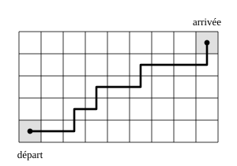

## Statement

Un rectangle est quadrillé en $5$ lignes et $9$ colonnes de cases.

Un pion part de la case en bas à gauche et doit rejoindre la case en haut à droite. À chaque coup, il passe de sa case à la case voisine située soit juste au-dessus, soit juste à droite.

Combien de chemins différents le pion peut-il suivre ?

## Hints

1. Commence par un tout petit quadrillage, par exemple $2$ lignes et $2$ colonnes, et compte les chemins à la main. Puis essaie $2$ lignes et $3$ colonnes.
2. Écris dans chaque case le nombre de chemins qui mènent du départ jusqu'à cette case. Combien vaut ce nombre pour les cases de la ligne du bas ? Et pour celles de la colonne de gauche ?
3. Pour arriver dans une case, le pion vient forcément de la case de gauche ou de la case du dessous. Quelle relation cela donne-t-il entre les trois nombres ?
4. Autre piste, complètement différente : quel que soit le chemin choisi, combien de déplacements vers la droite et combien vers le haut le pion fait-il en tout ?

## Solution

### Première méthode : compter de proche en proche

*L'idée : au lieu de compter les chemins jusqu'à l'arrivée, on compte les chemins jusqu'à chaque case.*

Écrivons dans chaque case le nombre de chemins qui mènent du départ jusqu'à cette case.

- Pour les cases de la **ligne du bas**, il n'y a qu'un seul chemin : aller tout droit vers la droite. On écrit $1$ dans chacune.
- Pour les cases de la **colonne de gauche**, même chose : monter tout droit. On écrit $1$ dans chacune.
- Pour toute autre case, le pion y arrive soit par la gauche, soit par le bas, et jamais les deux à la fois pour un même chemin. Le nombre de chemins qui aboutissent dans cette case est donc la **somme** des deux nombres déjà écrits dans la case de gauche et dans la case du dessous.

On remplit alors le quadrillage de proche en proche, en partant du coin en bas à gauche :

| colonne | 1 | 2 | 3 | 4 | 5 | 6 | 7 | 8 | 9 |
| --- | --- | --- | --- | --- | --- | --- | --- | --- | --- |
| ligne 5 (haut) | 1 | 5 | 15 | 35 | 70 | 126 | 210 | 330 | **495** |
| ligne 4 | 1 | 4 | 10 | 20 | 35 | 56 | 84 | 120 | 165 |
| ligne 3 | 1 | 3 | 6 | 10 | 15 | 21 | 28 | 36 | 45 |
| ligne 2 | 1 | 2 | 3 | 4 | 5 | 6 | 7 | 8 | 9 |
| ligne 1 (bas) | 1 | 1 | 1 | 1 | 1 | 1 | 1 | 1 | 1 |

La case d'arrivée, en haut à droite, porte le nombre $495$.

### Deuxième méthode : choisir les montées

*L'idée : tous les chemins ont la même longueur.*

Il y a $9$ colonnes, donc le pion se déplace $8$ fois vers la droite. Il y a $5$ lignes, donc il se déplace $4$ fois vers le haut. Quel que soit le chemin, il fait donc exactement

$$8 + 4 = 12 \text{ déplacements}$$

Un chemin est entièrement décrit par la réponse à la question : « parmi ces $12$ déplacements, lesquels sont des montées ? » Il faut en choisir $4$.

Comptons d'abord les choix ordonnés : la première montée peut être l'un des $12$ déplacements, la deuxième l'un des $11$ restants, la troisième l'un des $10$ restants, la quatrième l'un des $9$ restants, soit

$$12 \times 11 \times 10 \times 9 = 11\,880$$

Mais l'ordre dans lequel on désigne les quatre montées n'a aucune importance. Chaque groupe de quatre montées a donc été compté $4 \times 3 \times 2 \times 1 = 24$ fois. On divise :

$$\frac{11\,880}{24} = 495$$

On retrouve bien le même nombre.

**Réponse.** Le pion a $495$ chemins possibles.

## Going further

Regarde les nombres de la première méthode en les lisant en diagonale : $1$ ; $1,\ 1$ ; $1,\ 2,\ 1$ ; $1,\ 3,\ 3,\ 1$ ; $1,\ 4,\ 6,\ 4,\ 1$… C'est le triangle de Pascal. Ce n'est pas un hasard : les nombres du triangle de Pascal se construisent exactement par la même règle, « chaque nombre est la somme des deux nombres au-dessus de lui ».
