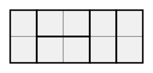

## Statement

On veut recouvrir entièrement une bande de $2$ cases de haut sur $n$ cases de long à l'aide de dominos de $1$ case sur $2$ cases. Les dominos ne doivent ni se chevaucher ni dépasser de la bande ; chacun se pose soit couché, soit debout.

Deux recouvrements sont différents dès que les dominos ne sont pas aux mêmes endroits. La bande reste posée comme elle est : on ne la retourne pas.

1. Combien y a-t-il de recouvrements d'une bande $2 \times 3$ ?
2. Même question pour une bande $2 \times 4$, puis pour une bande $2 \times 5$.
3. Sophie compte le nombre de recouvrements d'une bande $2 \times 2018$, puis elle en retranche le nombre de recouvrements d'une bande $2 \times 2017$. Natacha, de son côté, compte le nombre de recouvrements d'une bande $2 \times 2016$. Laquelle des deux obtient le plus grand résultat ?

## Hints

1. Pour la bande $2 \times 3$, dessine-la et cherche tous les recouvrements à la main. Il y en a peu.
2. Notons $p(n)$ le nombre de recouvrements d'une bande $2 \times n$. Combien valent $p(1)$ et $p(2)$ ?
3. Pour la question 2, tu n'as pas envie de tout redessiner. Regarde la case tout en haut à gauche de la bande : le domino qui la recouvre est soit debout, soit couché. Il n'y a que ces deux cas.
4. Dans le premier cas, que reste-t-il à recouvrir ? Et dans le second cas, où se trouve forcément le deuxième domino ?
5. Tu obtiens une relation entre $p(n)$, $p(n-1)$ et $p(n-2)$. Écris-la pour $n = 2018$.

## Solution

Notons $p(n)$ le nombre de recouvrements d'une bande $2 \times n$.

**Les deux plus petits cas.**

- $p(1) = 1$ : une bande $2 \times 1$ n'a que $2$ cases, on y pose un seul domino debout.
- $p(2) = 2$ : une bande $2 \times 2$ se recouvre soit avec deux dominos debout, soit avec deux dominos couchés.

**L'idée : regarder ce qui se passe au bord gauche.**

Prenons une bande $2 \times n$ et intéressons-nous à la case en haut à gauche. Le domino qui la recouvre ne peut se placer que de deux façons.

**Cas 1 : ce domino est debout.** Il occupe alors toute la première colonne. Il reste à recouvrir une bande $2 \times (n-1)$, ce qui se fait de $p(n-1)$ façons.

**Cas 2 : ce domino est couché.** Il occupe la case en haut à gauche et sa voisine de droite. Regardons alors la case juste en dessous, en bas à gauche. Le domino qui la recouvre ne peut pas être debout, car la case au-dessus est déjà prise. Il est donc couché lui aussi. Les deux premières colonnes sont donc entièrement remplies par ces deux dominos couchés, et il reste une bande $2 \times (n-2)$, ce qui se fait de $p(n-2)$ façons.

Ces deux cas ne se mélangent pas et il n'y en a pas d'autres. Donc, pour tout $n \geqslant 3$ :

$$\boxed{\ p(n) = p(n-1) + p(n-2)\ }$$

**1. La bande $2 \times 3$.**

$$p(3) = p(2) + p(1) = 2 + 1 = 3$$

Il y a $3$ recouvrements. On peut les dessiner pour vérifier : trois dominos debout ; un domino debout à gauche et deux couchés à droite ; deux couchés à gauche et un debout à droite.

**2. Les bandes $2 \times 4$ et $2 \times 5$.**

$$p(4) = p(3) + p(2) = 3 + 2 = 5$$
$$p(5) = p(4) + p(3) = 5 + 3 = 8$$

**3. Sophie et Natacha.**

Sophie calcule $p(2018) - p(2017)$, Natacha calcule $p(2016)$.

La relation appliquée à $n = 2018$ donne

$$p(2018) = p(2017) + p(2016)$$

donc

$$p(2018) - p(2017) = p(2016)$$

**Conclusion.** Aucune des deux ne l'emporte : Sophie et Natacha obtiennent exactement le même résultat. Et on n'a jamais eu besoin de calculer ces nombres, qui sont gigantesques.

## Going further

1. Calculer $p(6)$, $p(7)$ et $p(8)$. La suite $1, 2, 3, 5, 8, 13, 21, 34, \ldots$ porte un nom : le reconnais-tu ?
2. Pour quelles valeurs de $n$ le nombre $p(n)$ est-il pair ? Observe les premiers termes, propose une règle, puis explique-la avec la relation $p(n) = p(n-1) + p(n-2)$.
3. Beaucoup plus difficile : combien y a-t-il de recouvrements d'une bande $3 \times n$ ? Commence par $3 \times 2$ et $3 \times 4$, et remarque d'abord que c'est impossible quand $n$ est impair.
