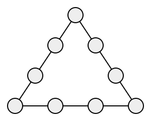

## Statement

Neuf ronds sont disposés le long des côtés d'un triangle : un à chaque sommet, et deux sur chaque côté entre les sommets.

Placer les nombres $1, 2, 3, \dots, 9$ dans ces ronds, chacun une seule fois, de façon que la somme des quatre nombres situés sur chaque côté du triangle soit égale à $17$.

## Hints

1. Un nombre placé à un sommet appartient à deux côtés à la fois. Un nombre placé entre deux sommets n'appartient qu'à un seul côté.
2. Additionne les trois sommes des côtés : tu obtiens $3 \times 17$. Compare ce total à $1 + 2 + \dots + 9$. D'où vient la différence ?
3. La différence est exactement la somme des trois nombres placés aux sommets. Combien vaut-elle ?
4. Trois nombres différents, choisis entre $1$ et $9$, dont la somme vaut $6$ : il n'y a pas le choix.
5. Une fois les sommets connus, chaque côté doit être complété par deux nombres dont tu connais la somme. Il reste à répartir $4, 5, 6, 7, 8, 9$.

## Solution

**Étape 1. Trouver les nombres des sommets.**

Additionnons les trois sommes des côtés. Comme chaque côté doit faire $17$, ce total vaut
$$3 \times 17 = 51$$

Regardons maintenant quels nombres ont été comptés dans cette addition, et combien de fois :

- un nombre placé **entre** deux sommets appartient à un seul côté : il est compté **une** fois ;
- un nombre placé **à un sommet** appartient à deux côtés : il est compté **deux** fois.

Donc $51$ est égal à la somme de tous les nombres, plus une fois de plus la somme des trois nombres des sommets. Or la somme de tous les nombres vaut
$$1 + 2 + 3 + \dots + 9 = 45$$

La somme des trois nombres des sommets vaut donc
$$51 - 45 = 6$$

Quels sont ces trois nombres ? Ils sont différents et choisis entre $1$ et $9$. Les trois plus petits, $1$, $2$ et $3$, font déjà $1 + 2 + 3 = 6$ : tout autre choix donnerait une somme plus grande. Les sommets portent donc forcément $\mathbf{1}$, $\mathbf{2}$ et $\mathbf{3}$.

**Étape 2. Compléter les côtés.**

Plaçons $1$, $2$ et $3$ aux trois sommets. Sur chaque côté, les deux nombres du milieu doivent compléter les deux sommets jusqu'à $17$ :

- côté qui relie $1$ et $2$ : il manque $17 - (1 + 2) = 14$ ;
- côté qui relie $2$ et $3$ : il manque $17 - (2 + 3) = 12$ ;
- côté qui relie $1$ et $3$ : il manque $17 - (1 + 3) = 13$.

Il nous reste à placer les six nombres $4, 5, 6, 7, 8, 9$, deux par côté. Cherchons :
$$14 = 9 + 5, \qquad 12 = 8 + 4, \qquad 13 = 7 + 6$$

Ces trois écritures utilisent chacun des six nombres restants exactement une fois : c'est gagné.

**Une réponse.**

- Sommets : $1$, $2$, $3$.
- Entre $1$ et $2$ : $9$ et $5$.
- Entre $2$ et $3$ : $8$ et $4$.
- Entre $1$ et $3$ : $7$ et $6$.

Vérification côté par côté :
$$1 + 9 + 5 + 2 = 17, \qquad 2 + 8 + 4 + 3 = 17, \qquad 3 + 7 + 6 + 1 = 17$$

**Conclusion.**

Un tel placement existe, et il est donné ci-dessus. Il y a plusieurs réponses possibles (on peut échanger les deux nombres d'un même côté, ou faire tourner la figure), mais l'étape 1 montre que dans **toutes** les réponses, les sommets portent $1$, $2$ et $3$.

## Going further

1. Peut-on obtenir $20$ sur chaque côté ? Et $21$ ?
2. Montrer que la somme commune des côtés ne peut être que l'un des nombres $17, 18, 19, 20, 21, 22, 23$.
