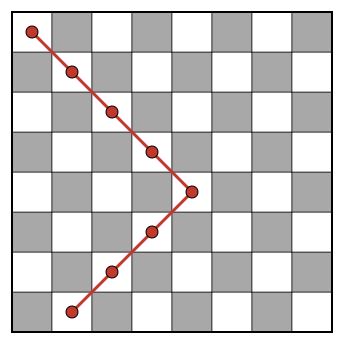
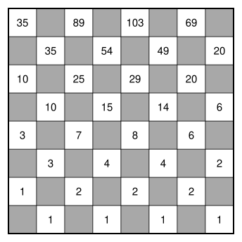

## Statement

On considère un échiquier ordinaire de $8 \times 8$ cases, colorié comme d'habitude : la case en
bas à gauche est noire.

Un **zigzag** est un chemin qui ne passe que par des cases blanches. Il part d'une case blanche
quelconque de la ligne du bas, et monte ligne par ligne jusqu'à la ligne du haut : à chaque étape,
il passe dans l'une des cases voisines **en diagonale** de la ligne du dessus.

Combien y a-t-il de zigzags ?

## Hints

1. Combien de zigzags différents peuvent arriver sur chaque case blanche de la deuxième ligne ?
   Et de la troisième ?
2. Juste avant d'arriver sur une case, un zigzag est passé par l'une des cases voisines en
   diagonale de la ligne du dessous. Combien y en a-t-il ?
3. Écris dans chaque case blanche le nombre de façons d'y arriver en partant de la ligne du bas,
   en remplissant l'échiquier ligne après ligne.

## Solution

**L'idée : compter les façons d'arriver sur chaque case.**

Pour chaque case blanche, comptons le nombre de débuts de zigzag qui partent de la ligne du bas
et arrivent sur cette case. Juste avant d'arriver sur une case, le chemin était sur l'une des
cases voisines en diagonale de la ligne du dessous. Il y en a deux, sauf au bord de l'échiquier,
où il n'y en a qu'une. Donc :

> le nombre de façons d'arriver sur une case est la **somme** des nombres écrits dans les cases
> voisines en diagonale de la ligne du dessous.

**Remplir l'échiquier.**

Sur la ligne du bas, on écrit $1$ dans chacune des quatre cases blanches : un zigzag peut
commencer sur chacune d'elles, d'une seule façon. Puis on remplit la deuxième ligne, la
troisième, et ainsi de suite, en appliquant la règle. Par exemple, sur la deuxième ligne, la case
de gauche ne reçoit qu'un chemin, et les trois autres en reçoivent deux.

**Le compte.**

Un zigzag se termine sur l'une des quatre cases blanches de la ligne du haut. Le nombre total de
zigzags est donc la somme des nombres écrits sur cette ligne :
$$35 + 89 + 103 + 69 = 296 .$$

**Conclusion : il y a $296$ zigzags.**
