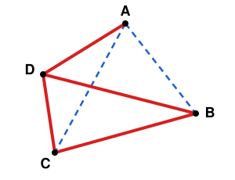

## Statement

On place quatre points dans le plan, sans que trois d'entre eux soient jamais alignés, et on trace
les six segments qui les relient deux à deux. On colorie chacun de ces six segments, soit en
rouge, soit en bleu.

Les quatre points forment quatre triangles. On dit que deux triangles sont **coloriés de la même
façon** s'ils ont le même nombre de côtés rouges.

Montrer qu'il existe toujours deux triangles différents coloriés de la même façon.

Par exemple, dans le dessin ci-dessous, les segments rouges sont en trait plein et les segments
bleus en pointillés. Les triangles $ABD$ et $ACD$ ont chacun deux côtés rouges et un côté bleu :
ils sont coloriés de la même façon.

## Hints

1. Combien y a-t-il de triangles en tout ? Et combien de côtés rouges un triangle peut-il avoir ?
2. Si deux triangles ont le même nombre de côtés rouges, c'est gagné. Suppose que ce ne soit pas le
   cas : que peut-on dire alors des quatre triangles ?
3. Deux triangles différents formés avec ces quatre points ont-ils un côté en commun ?

## Solution

Appelons les quatre points $A$, $B$, $C$ et $D$. Un triangle est formé de trois des quatre points :
on l'obtient en laissant de côté un seul point. Il y a donc exactement quatre triangles : $BCD$,
$ACD$, $ABD$ et $ABC$.

**Deux triangles ont toujours un côté commun.** Prenons deux triangles différents. Chacun laisse de
côté un point, et ce n'est pas le même. Les deux autres points appartiennent donc aux deux
triangles à la fois, et le segment qui les relie est un côté des deux triangles. Par exemple, $ABC$
et $ABD$ ont le côté $[AB]$ en commun.

**Le raisonnement.** Un triangle a $0$, $1$, $2$ ou $3$ côtés rouges : il y a quatre possibilités.

Supposons que les quatre triangles soient tous coloriés de façons différentes. Comme il y a quatre
triangles et quatre possibilités, chaque possibilité est prise exactement une fois. En particulier :

- un des triangles a $3$ côtés rouges : il est entièrement rouge ;
- un autre a $0$ côté rouge : il est entièrement bleu.

Ces deux triangles sont différents, donc ils ont un côté commun. Ce côté serait à la fois rouge
(comme tous les côtés du premier) et bleu (comme tous les côtés du second). C'est impossible, car
chaque segment a une seule couleur.

La supposition est donc fausse.

**Conclusion : parmi les quatre triangles, il y en a toujours au moins deux qui ont le même nombre de
côtés rouges, c'est-à-dire deux triangles coloriés de la même façon.**

## Going further

Avec **cinq** points, trois jamais alignés, et les dix segments qui les relient coloriés en rouge ou
en bleu, il y a dix triangles. Montrer qu'il y en a toujours au moins trois coloriés de la même
façon. (Il y a seulement quatre possibilités pour dix triangles : si chaque possibilité était prise
au plus deux fois, on n'aurait que huit triangles au plus.)
