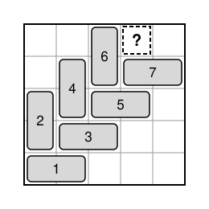

## Statement

Soit $n \geqslant 1$ un entier. On veut recouvrir entièrement une grille carrée de $n \times n$ cases
avec des dominos de $1 \times 2$ cases, sans qu'ils se chevauchent ni dépassent de la grille.

On ajoute une règle : **deux dominos ne doivent jamais former un carré de $2 \times 2$ cases.**

Pour quels entiers $n$ est-ce possible ?

## Hints

1. Regarde la case d'un coin de la grille. Le domino qui la couvre est couché ou debout ; quitte à
   tourner la grille, on peut supposer qu'il est couché.
2. Regarde maintenant la case juste au-dessus de ce coin. Comment le domino qui la couvre peut-il
   être placé ?
3. Continue de proche en proche : chaque domino suivant est obligé. Ils forment un escalier. Où cet
   escalier finit-il ?

## Solution

**Réponse : ce n'est possible pour aucun entier $n$.**

Remarquons d'abord quand deux dominos forment un carré $2 \times 2$ : c'est quand ils sont
parallèles et posés l'un contre l'autre sur toute leur longueur.

Supposons qu'un tel recouvrement existe. Pour $n = 1$, c'est impossible, car un domino ne tient pas
dans une seule case. Supposons donc $n \geqslant 2$. On repère les cases comme dans un repère : la
case $(a\,;b)$ est celle de la colonne numéro $a$ (en comptant de gauche à droite) et de la ligne
numéro $b$ (en comptant de bas en haut). La case $(1\,;1)$ est le coin en bas à gauche.

### Les dominos sont obligés

Le domino qui couvre le coin $(1\,;1)$ est couché ou debout. Quitte à faire une symétrie de la
grille par rapport à sa diagonale (qui échange les dominos couchés et les dominos debout), on peut
supposer qu'il est couché : il couvre $(1\,;1)$ et $(2\,;1)$. C'est le domino $1$ de la figure.

Le domino qui couvre une case la relie à l'une de ses quatre voisines (gauche, droite, haut, bas).

- **La case $(1\,;2)$.** Sa voisine de gauche est hors de la grille, et celle du bas est déjà prise
  par le domino $1$. Si son domino allait à droite, il couvrirait $(1\,;2)$ et $(2\,;2)$, et
  formerait un carré $2 \times 2$ avec le domino $1$. Donc il va vers le haut : c'est le domino $2$,
  debout, sur $(1\,;2)$ et $(1\,;3)$.
- **La case $(2\,;2)$.** Sa voisine de gauche est prise par le domino $2$, celle du bas par le
  domino $1$. Si son domino allait vers le haut, il serait debout contre le domino $2$ et formerait
  un carré avec lui. Donc il va à droite : c'est le domino $3$, couché, sur $(2\,;2)$ et $(3\,;2)$.
- **La case $(2\,;3)$.** Sa voisine de gauche est prise par le domino $2$, celle du bas par le
  domino $3$. À droite, le domino serait couché sur le domino $3$ et formerait un carré. Donc il va
  vers le haut : c'est le domino $4$, debout, sur $(2\,;3)$ et $(2\,;4)$.

Et le même raisonnement se répète, en montant d'une ligne et en avançant d'une colonne à chaque
fois. Pour chaque $k$, on trouve un domino couché sur $(k\,;k)$ et $(k+1\,;k)$, puis un domino
debout sur $(k\,;k+1)$ et $(k\,;k+2)$ :

- la case $(k\,;k+1)$ a sa voisine de gauche prise par le domino debout précédent (ou hors de la
  grille si $k = 1$), sa voisine du bas prise par le domino couché sur $(k\,;k)$, et à droite on
  formerait un carré avec ce domino couché : son domino va donc vers le haut ;
- la case $(k+1\,;k+1)$ a sa voisine de gauche prise par ce domino debout, sa voisine du bas prise
  par le domino couché, et vers le haut on formerait un carré avec le domino debout : son domino va
  donc à droite.

On obtient un escalier de dominos qui monte le long de la diagonale.

### L'escalier sort de la grille

L'escalier ne peut pas continuer indéfiniment dans une grille de taille $n$. Arrivé au domino
couché sur $(n-1\,;n-1)$ et $(n\,;n-1)$, regardons la case $(n-1\,;n)$, sur la ligne du haut. Sa
voisine de gauche est prise par le domino debout précédent (ou hors de la grille si $n = 2$), celle
du bas par le domino couché, et à droite on formerait un carré avec ce domino couché. Il faudrait
donc aller vers le haut, c'est-à-dire sortir de la grille. Cette case ne peut pas être couverte :
c'est une contradiction.

**Conclusion : quel que soit $n$, on ne peut pas recouvrir la grille $n \times n$ avec des dominos
sans que deux d'entre eux forment un carré $2 \times 2$.**

## Going further

- Montre de la même façon qu'un rectangle d'au moins $2$ lignes et d'au moins $2$ colonnes ne peut
  jamais être recouvert de dominos sans que deux d'entre eux forment un carré $2 \times 2$. Où
  l'escalier sort-il du rectangle ?
- Et pour une bande d'une seule ligne de $2m$ cases ?
