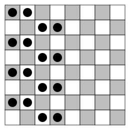

## Statement

On considère un échiquier $8 \times 8$ dont les cases sont coloriées en blanc et en noir, comme d'habitude, en alternant les couleurs.

Une **tour infernale** est une pièce qui attaque :

- sur sa **ligne**, les cases de **la même couleur** que la sienne ;
- sur sa **colonne**, les cases de **l'autre couleur**.

Combien peut-on placer de tours infernales, au maximum, sur l'échiquier, de sorte qu'aucune tour infernale n'en attaque une autre ?

## Hints

1. Combien de tours infernales peut-on mettre sur une même ligne sans qu'elles s'attaquent ? Que se passe-t-il si on en met trois ?
2. Tu obtiens ainsi un nombre maximal de tours sur tout l'échiquier. Il reste à montrer qu'on peut l'atteindre.
3. Pour la construction, regarde aussi les colonnes : deux tours sur une même colonne doivent être sur des cases de même couleur. Sur une colonne, une case sur deux a la même couleur.
4. Essaie de mettre deux tours côte à côte sur chaque ligne, et décale le couple d'une ligne à l'autre.

## Solution

Pour trouver un maximum, il faut faire deux choses : montrer qu'on ne peut pas dépasser un certain nombre, puis donner un exemple qui l'atteint.

**On ne peut pas placer plus de 16 tours.**

Si deux tours infernales sont sur la même ligne et sur des cases de même couleur, elles s'attaquent. Sur une ligne, il ne peut donc y avoir au plus qu'une tour sur une case blanche et une tour sur une case noire : au plus $2$ tours par ligne. Si on en mettait trois, deux d'entre elles seraient sur des cases de même couleur, puisqu'il n'y a que deux couleurs.

Comme il y a $8$ lignes, il y a au plus $2 \times 8 = 16$ tours infernales.

**On peut placer 16 tours.**

Sur les lignes $1$, $3$, $5$ et $7$, on place deux tours dans les colonnes $1$ et $2$. Sur les lignes $2$, $4$, $6$ et $8$, on place deux tours dans les colonnes $3$ et $4$.

Vérifions qu'aucune tour n'en attaque une autre.

- **Sur chaque ligne**, les deux tours sont sur deux cases voisines, donc de couleurs différentes : elles ne s'attaquent pas.
- **Sur chaque colonne utilisée**, les tours sont sur des lignes de même parité (toutes impaires, ou toutes paires). En descendant de deux lignes dans une colonne, on retrouve la même couleur. Toutes les tours d'une même colonne sont donc sur des cases de même couleur, et une tour n'attaque sur sa colonne que les cases de l'autre couleur : elles ne s'attaquent pas.

Cette disposition compte bien $8 \times 2 = 16$ tours.

**Conclusion.** Le nombre maximal de tours infernales est $16$.

*Attention à une erreur fréquente.* Montrer qu'on ne peut plus ajouter de tour à un exemple de $16$ tours ne prouve pas que $16$ est le maximum : une disposition complètement différente pourrait peut-être en contenir davantage. C'est l'argument « au plus deux par ligne » qui le prouve.

## Going further

Une **tour diabolique** attaque, sur sa ligne **et** sur sa colonne, les cases de sa propre couleur. Combien peut-on en placer, au maximum, sur l'échiquier sans qu'elles s'attaquent ?
