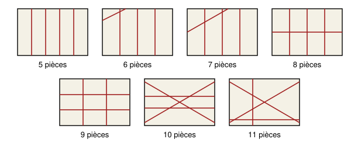

## Statement

Mathieu prend une feuille de papier rectangulaire. Il y trace à la règle quatre lignes droites différentes. Chacune va d'un bord de la feuille à un autre bord, et aucune n'est elle-même un bord de la feuille. Ensuite, il découpe la feuille le long de chacune des quatre lignes.

Combien de pièces peut-il obtenir ? Dessine un exemple pour chaque nombre de pièces possible, et explique pourquoi il n'y a pas d'autre possibilité.

## Hints

1. Découpe le long des lignes une par une. La première ligne donne deux pièces. Combien de pièces la deuxième peut-elle ajouter ?
2. Quand on trace une nouvelle ligne, les lignes déjà tracées la coupent en plusieurs morceaux. Que fait chacun de ces morceaux à la pièce qu'il traverse ?
3. Combien de pièces la quatrième ligne peut-elle ajouter, au plus et au moins ?

## Solution

La réponse : Mathieu peut obtenir **$5$, $6$, $7$, $8$, $9$, $10$ ou $11$ pièces**, et aucun autre nombre.

**Ce qui se passe quand on ajoute une ligne.** Toutes les pièces sont des polygones convexes, c'est-à-dire sans partie rentrante : c'est vrai pour la feuille au départ, et quand on coupe un polygone convexe le long d'une droite, on obtient deux polygones convexes. Une droite traverse donc chaque pièce au plus une fois, en un seul morceau.

On trace les lignes l'une après l'autre. Supposons que la nouvelle ligne rencontre les lignes déjà tracées en $k$ points différents, à l'intérieur de la feuille. Ces $k$ points la découpent en $k + 1$ morceaux. Chaque morceau ne rencontre aucune ligne déjà tracée, donc il reste dans une seule pièce, et il coupe cette pièce en deux. Deux morceaux différents sont dans deux pièces différentes, d'après ce qu'on vient de dire. La nouvelle ligne fait donc passer le nombre de pièces de $N$ à $N + k + 1$.

**Le compte.** Une nouvelle ligne rencontre au plus une fois chacune des lignes déjà tracées.

- La première ligne coupe la feuille en $2$ pièces.
- La deuxième rencontre $0$ ou $1$ ligne : elle ajoute $1$ ou $2$ pièces.
- La troisième rencontre au plus $2$ lignes : elle ajoute $1$, $2$ ou $3$ pièces.
- La quatrième rencontre au plus $3$ lignes : elle ajoute $1$, $2$, $3$ ou $4$ pièces.

Le nombre de pièces est donc au moins $2 + 1 + 1 + 1 = 5$ et au plus $2 + 2 + 3 + 4 = 11$. Autrement dit, il vaut $5$ plus le nombre de points de croisement (si trois lignes passent par un même point, ce point compte pour deux croisements). Ce nombre de croisements est entre $0$ et $6$.

**Tous les nombres de $5$ à $11$ sont possibles.** Voici un exemple pour chacun.

- $5$ pièces : quatre lignes parallèles, aucun croisement.
- $6$ pièces : trois lignes parallèles et une ligne qui coupe un coin en ne croisant que la première.
- $7$ pièces : la quatrième ligne croise deux des trois parallèles.
- $8$ pièces : la quatrième ligne croise les trois parallèles.
- $9$ pièces : deux lignes verticales et deux lignes horizontales, quatre croisements.
- $10$ pièces : deux lignes horizontales et deux lignes obliques qui se croisent entre elles : $1 + 4 = 5$ croisements.
- $11$ pièces : quatre lignes qui se croisent deux à deux en six points différents.

**Conclusion.** Le nombre de pièces est forcément entre $5$ et $11$, et chacun de ces sept nombres peut être obtenu.

## Going further

Avec cinq lignes droites, combien de pièces peut-on obtenir au plus ? Et avec $n$ lignes ?
