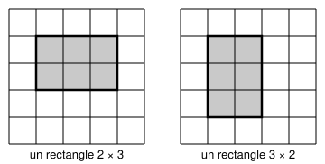
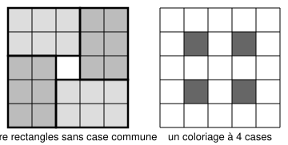

## Statement

On dispose d'une grille $5 \times 5$ de $25$ cases blanches.

Vincent veut colorier en rouge certaines cases, de telle sorte que **tout** rectangle $2 \times 3$ ou $3 \times 2$ tracé dans la grille contienne au moins une case rouge.

Quel est le plus petit nombre de cases qu'il doit colorier ?

Ci-dessous, à gauche un rectangle $2 \times 3$ (deux lignes, trois colonnes), à droite un rectangle $3 \times 2$ (trois lignes, deux colonnes).

## Hints

1. Cherche d'abord un coloriage qui marche, avec le moins de cases possible. Combien arrives-tu à descendre ?
2. Trouver un coloriage à $4$ cases ne suffit pas : il faut aussi démontrer que $3$ cases ne peuvent pas suffire. Ce sont deux travaux séparés.
3. Pour la borne : si tu trouves plusieurs rectangles $2 \times 3$ ou $3 \times 2$ qui n'ont **aucune case en commun**, que peux-tu dire ?
4. Essaie de caser quatre tels rectangles dans la grille $5 \times 5$ sans qu'ils se chevauchent. Il y a $25$ cases et $4 \times 6 = 24$ : ça passe tout juste.

## Solution

La réponse est $4$. Il y a deux choses à démontrer, et elles sont indépendantes l'une de l'autre.

**1. Il faut au moins 4 cases.**

On peut placer dans la grille quatre rectangles $2 \times 3$ ou $3 \times 2$ **sans aucune case commune**, disposés en moulinet autour de la case centrale (figure de gauche ci-dessous).

Chacun de ces quatre rectangles doit contenir au moins une case rouge. Comme ils n'ont aucune case commune, ces quatre cases rouges sont forcément différentes les unes des autres. Il y a donc au moins $4$ cases rouges.

**2. Quatre cases suffisent.**

Colorions les quatre cases situées à l'intersection des lignes $2$ et $4$ avec les colonnes $2$ et $4$ (figure de droite).

Vérifions que tout rectangle est touché. Un rectangle $2 \times 3$ occupe **deux lignes consécutives** et **trois colonnes consécutives**.

- Deux lignes consécutives parmi $1, 2, 3, 4, 5$ : ce sont $(1,2)$, $(2,3)$, $(3,4)$ ou $(4,5)$. Chacune de ces paires contient la ligne $2$ ou la ligne $4$.
- Trois colonnes consécutives : ce sont $(1,2,3)$, $(2,3,4)$ ou $(3,4,5)$. Chacun de ces blocs contient la colonne $2$ ou la colonne $4$.

Le rectangle contient donc une ligne coloriée et une colonne coloriée, et la case où elles se croisent est rouge et appartient au rectangle.

Le raisonnement pour un rectangle $3 \times 2$ est le même en échangeant les rôles des lignes et des colonnes.

**Conclusion.** Le plus petit nombre de cases à colorier est $\boxed{4}$.

## Going further

L'erreur la plus fréquente, signalée par les correcteurs, mérite d'être connue : beaucoup d'élèves ont écrit « voici un coloriage à $4$ cases, et si j'en enlève une il ne marche plus, donc $4$ est le minimum ».

C'est faux. Cela prouve seulement que **ce** coloriage-là n'a pas de gras à perdre, pas qu'un tout autre coloriage à $3$ cases n'existe pas. Pour interdire $3$ cases il faut un argument qui parle de **tous** les coloriages à la fois : ici, les quatre rectangles sans case commune.

Il existe d'ailleurs plusieurs coloriages à $4$ cases qui conviennent, pas seulement celui de la figure. Sauras-tu en trouver un autre ?
