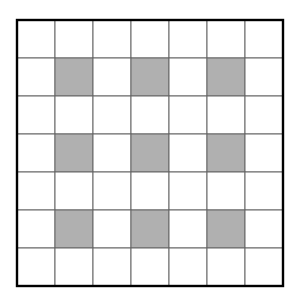
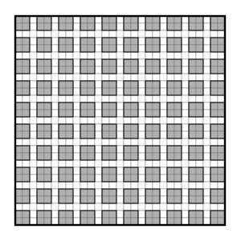

## Statement

On travaille sur du papier quadrillé et **on découpe toujours en suivant les lignes du quadrillage**.

1. Peut-on découper $10$ carrés de $2 \times 2$ cases dans un carré de $7 \times 7$ cases ?
2. Dans une feuille de $29 \times 29$ cases, on a découpé $99$ carrés de $2 \times 2$ cases. Montrer que, dans ce qui reste de la feuille, on peut encore découper au moins un carré de $2 \times 2$ cases.

## Hints

1. Dans la question 1, il ne s'agit pas d'essayer des découpages au hasard : il faut prouver que $10$ est impossible. Cherche donc quelque chose dont chaque carré $2 \times 2$ consomme exactement un exemplaire.
2. Numérote les lignes et les colonnes du carré $7 \times 7$ de $1$ à $7$, et marque les cases dont le numéro de ligne **et** le numéro de colonne sont pairs. Combien y en a-t-il ?
3. Prends un carré $2 \times 2$ n'importe où sur le quadrillage. Il occupe deux lignes qui se suivent : parmi deux nombres qui se suivent, combien y en a-t-il de pairs ? Combien de cases marquées contient-il donc ?
4. Pour la question 2, on ne marque plus des cases isolées : on va marquer des **blocs** de $2 \times 2$ cases, en les espaçant d'une ligne et d'une colonne. Combien en fait-on tenir dans $29 \times 29$ ?
5. Question 2 : montre qu'un carré $2 \times 2$ découpé n'abîme jamais deux blocs à la fois. Que reste-t-il après $99$ découpages ?

## Solution

L'idée est la même dans les deux questions : **marquer d'avance certaines cases du quadrillage**, choisies de façon que chaque carré $2 \times 2$ découpé en consomme exactement une part. Il suffit ensuite de compter.

### 1. Dix carrés dans le $7 \times 7$ : impossible

**Le marquage.** Numérotons les lignes de $1$ à $7$ de haut en bas et les colonnes de $1$ à $7$ de gauche à droite. Marquons les cases dont le numéro de ligne **et** le numéro de colonne sont pairs, c'est-à-dire les lignes $2$, $4$, $6$ croisées avec les colonnes $2$, $4$, $6$. Cela fait

$$3 \times 3 = 9 \text{ cases marquées}$$

**Chaque carré $2 \times 2$ contient exactement une case marquée.**

Un carré $2 \times 2$ occupe deux lignes qui se suivent et deux colonnes qui se suivent. Or, parmi deux nombres qui se suivent, il y en a exactement un qui est pair. Donc :

- parmi ses deux lignes, exactement une porte un numéro pair ;
- parmi ses deux colonnes, exactement une porte un numéro pair.

Une seule de ses quatre cases se trouve donc à la fois sur la ligne paire et sur la colonne paire : c'est la seule case marquée qu'il contient.

**On compte.** Les carrés découpés ne se chevauchent pas. Chacun contient une case marquée, et deux carrés différents ne peuvent pas contenir la même, puisqu'ils n'ont aucune case commune. Chaque carré découpé consomme donc une case marquée **qui lui est propre**.

Comme il n'y a que $9$ cases marquées, on ne peut pas découper plus de $9$ carrés.

**Conclusion.** Non, on ne peut pas découper $10$ carrés $2 \times 2$ dans un carré $7 \times 7$. On peut d'ailleurs en découper $9$, en les rangeant dans les lignes $1$-$2$, $3$-$4$, $5$-$6$ et les colonnes $1$-$2$, $3$-$4$, $5$-$6$ : la dernière ligne et la dernière colonne restent inutilisées. Le maximum est donc exactement $9$.

### 2. Un centième carré dans le $29 \times 29$

Ici on ne marque plus des cases isolées, mais des **blocs** de $2 \times 2$ cases.

**Le marquage.** Réservons les lignes par paquets de deux, en laissant une ligne libre entre chaque paquet :

$$1\text{-}2,\quad 4\text{-}5,\quad 7\text{-}8,\quad 10\text{-}11,\ \ldots,\ 28\text{-}29$$

Les paquets commencent aux lignes $1, 4, 7, \ldots, 28$ : il y en a $10$, et le dernier tombe pile sur les lignes $28$ et $29$. Faisons exactement la même chose avec les colonnes. En croisant, on obtient

$$10 \times 10 = 100 \text{ blocs de } 2 \times 2 \text{ cases}$$

Ces blocs ne se touchent pas : ils sont séparés par les lignes $3, 6, 9, \ldots, 27$ et par les colonnes de mêmes numéros.

**Un carré découpé n'abîme jamais deux blocs.**

Un carré $2 \times 2$ découpé occupe deux lignes qui se suivent. Pour toucher deux paquets de lignes différents, il lui faudrait contenir à la fois une ligne d'un paquet et une ligne du paquet suivant, par exemple les lignes $2$ et $4$. C'est impossible : ces lignes sont séparées par la ligne $3$, et deux lignes qui se suivent ne peuvent pas sauter par-dessus une ligne.

Le carré découpé touche donc au plus un paquet de lignes, et de même au plus un paquet de colonnes : il rencontre **au plus un bloc**.

**On compte.** Chacun des $99$ carrés découpés abîme au plus un bloc. À eux tous, ils abîment donc au plus $99$ blocs. Comme il y a $100$ blocs, **au moins un bloc n'a pas été touché du tout**.

Ce bloc est encore entier, et c'est précisément un carré de $2 \times 2$ cases posé sur les lignes du quadrillage.

**Conclusion.** Il reste toujours au moins un carré $2 \times 2$ à découper, quel que soit l'endroit où les $99$ premiers ont été pris.

## Going further

1. Quel est le nombre maximal de carrés $2 \times 2$ que l'on peut découper dans un carré $9 \times 9$ ? Et dans un carré de côté impair $2k+1$ ?
2. Dans la question 2, combien de carrés $2 \times 2$ faudrait-il avoir déjà découpés pour que le raisonnement ne garantisse plus rien ?
3. Reprendre la question 1 avec des carrés $3 \times 3$ à découper dans un carré $10 \times 10$ : quel marquage faut-il inventer, et combien de carrés obtient-on au maximum ?
