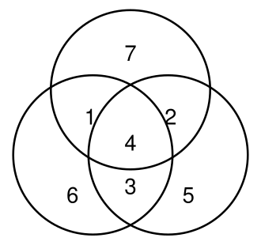
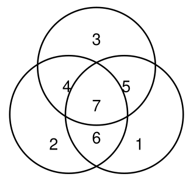
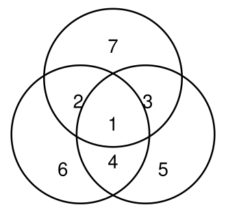

## Statement

Les trois cercles de la figure ci-dessous déterminent sept zones, dans chacune desquelles on
écrit un des nombres $1$, $2$, $3$, $4$, $5$, $6$, $7$ (chacun une seule fois). On cherche à
placer ces nombres de telle façon qu'en faisant la somme des quatre nombres contenus dans
chaque cercle, on obtienne le même total pour les trois cercles.

Dans l'exemple ci-dessous, ce total vaut $14$ : le cercle du haut contient $7 + 1 + 4 + 2$,
celui de gauche $6 + 1 + 4 + 3$ et celui de droite $5 + 2 + 4 + 3$.

Quelles sont les sommes maximale et minimale qu'on peut obtenir ? On devra montrer qu'il en
est ainsi. Rappel : pour être qualifiée de maximale ou minimale, une telle somme doit être
effectivement réalisée.

## Hints

1. Donne un nom à chaque zone. Il y en a trois qui n'appartiennent qu'à un seul cercle, trois qui appartiennent à exactement deux cercles, et une au centre qui appartient aux trois.
2. Additionne les trois totaux. Chaque nombre y apparaît, mais pas le même nombre de fois : combien de fois pour une zone simple ? une zone double ? la zone centrale ?
3. Tu devrais trouver $3S = 28 + (\text{les quatre nombres du milieu}) + (\text{le nombre du centre})$, où $28 = 1 + 2 + \ldots + 7$ et où « les quatre nombres du milieu » désigne les trois zones doubles et la zone centrale.
4. Pour obtenir la plus grande valeur possible de $S$, quels nombres faut-il mettre dans ces quatre zones, et lequel au centre ? Attention : trouver un majorant ne suffit pas, il faut ensuite exhiber un placement qui l'atteint.

## Solution

**Les notations.** Appelons
$h$, $g$, $d$ les nombres des trois zones qui n'appartiennent qu'à un seul cercle
(haut, gauche, droite) ;
$u$, $v$, $w$ les nombres des trois zones qui appartiennent à exactement deux cercles ;
et $c$ le nombre de la zone centrale, celle qui appartient aux trois cercles.

Les trois totaux sont alors
$$S_{\text{haut}} = h + u + v + c, \qquad S_{\text{gauche}} = g + u + w + c, \qquad S_{\text{droite}} = d + v + w + c.$$

On suppose qu'ils sont tous les trois égaux à un même nombre $S$.

**On compte la somme des trois totaux.** Additionnons les trois lignes. Chaque zone simple
apparaît une fois, chaque zone double apparaît deux fois (elle est dans deux cercles), et la
zone centrale trois fois :

$$3S = (h + g + d) + 2(u + v + w) + 3c.$$

Or les sept nombres sont $1, 2, \ldots, 7$, dont la somme vaut $28$. Donc
$h + g + d = 28 - (u+v+w) - c$, ce qui donne

$$3S = 28 - (u+v+w) - c + 2(u+v+w) + 3c = 28 + (u + v + w + c) + c.$$

C'est la clé du problème : $S$ ne dépend que de deux choses, la somme des **quatre nombres
du milieu** $u + v + w + c$, et le nombre du **centre** $c$.

**La borne supérieure.** Les quatre nombres $u$, $v$, $w$, $c$ sont quatre des sept nombres
$1, \ldots, 7$, donc au mieux ce sont $4$, $5$, $6$ et $7$ :

$$u + v + w + c \le 4 + 5 + 6 + 7 = 22,$$

et par ailleurs $c \le 7$. Donc

$$3S \le 28 + 22 + 7 = 57, \qquad \text{c'est-à-dire} \qquad S \le 19.$$

**La borne inférieure.** De même, au pire les quatre nombres du milieu sont $1$, $2$, $3$ et
$4$, donc $u + v + w + c \ge 1 + 2 + 3 + 4 = 10$, et $c \ge 1$. Donc

$$3S \ge 28 + 10 + 1 = 39, \qquad \text{c'est-à-dire} \qquad S \ge 13.$$

**Les deux valeurs sont atteintes.** Il reste à montrer que $19$ et $13$ sont réellement
réalisables.

Pour $S = 19$, on met $7$ au centre, puis $4$, $5$, $6$ dans les zones doubles et $3$, $2$,
$1$ dans les zones simples :

Les trois totaux valent $3 + 4 + 5 + 7 = 19$, $2 + 4 + 6 + 7 = 19$ et
$1 + 5 + 6 + 7 = 19$.

Pour $S = 13$, on fait exactement l'inverse : $1$ au centre, $2$, $3$, $4$ dans les zones
doubles et $5$, $6$, $7$ dans les zones simples :

Les trois totaux valent $7 + 2 + 3 + 1 = 13$, $6 + 2 + 4 + 1 = 13$ et
$5 + 3 + 4 + 1 = 13$.

**Réponse : la somme maximale est $19$ et la somme minimale est $13$.**

## Going further

L'égalité $3S = 28 + (u+v+w+c) + c$ montre que $S$ ne peut prendre que quelques valeurs. En
essayant toutes les valeurs possibles de $c$ on trouve que tous les totaux de $13$ à $19$
sont réalisables, et eux seuls.
