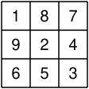

## Statement

On place les neuf entiers $1, 2, 3, \ldots, 9$ dans les neuf cases d'un tableau carré de $3$ lignes
et $3$ colonnes, chaque entier une fois. Par exemple :

Pour un tel tableau, on calcule le produit des trois nombres de chaque ligne ($56$, $72$ et $90$
dans l'exemple) et le produit des trois nombres de chaque colonne ($54$, $80$ et $84$ dans
l'exemple).

1. a) Montrer que, dans n'importe quel tableau de ce type, au moins une ligne a un produit
   supérieur ou égal à $72$.

   b) Donner un tableau de ce type dont les trois lignes ont chacune un produit inférieur ou égal
   à $72$.

2. Montrer que, dans n'importe quel tableau de ce type, au moins une ligne ou une colonne a un
   produit supérieur ou égal à $90$.

La calculatrice est autorisée.

## Hints

1. **Question 1 a).** Que vaut le produit des trois produits de lignes ? Il ne dépend pas du
   tableau.
2. **Question 1 a).** Raisonner par l'absurde : si chaque ligne avait un produit au plus égal à
   $71$, que pourrait-on dire du produit des trois ?
3. **Question 1 b).** Décomposer $1 \times 2 \times \cdots \times 9$ en $72 \times 72 \times 70$, puis
   chercher trois groupes de trois nombres qui donnent ces produits.
4. **Question 2.** Supposer que toutes les lignes et toutes les colonnes ont un produit au plus
   égal à $89$. Montrer d'abord que chaque ligne a alors un produit au moins égal à $46$, et de même
   pour chaque colonne.
5. **Question 2.** Regarder la ligne et la colonne qui contiennent le $1$. Quels peuvent être les
   deux autres nombres de cette ligne ?
6. **Question 2.** Les quatre nombres $6$, $7$, $8$ et $9$ sont alors tous sur la ligne ou sur la
   colonne du $1$. Où peut être le $5$, et avec qui partage-t-il sa ligne et sa colonne ?

## Solution

Notons $P = 1 \times 2 \times 3 \times \cdots \times 9 = 362\,880$. Chaque nombre du tableau est
dans exactement une ligne : le produit des trois produits de lignes vaut donc toujours $P$. De même,
le produit des trois produits de colonnes vaut $P$.

**1. a)** Supposons que les trois lignes aient chacune un produit au plus égal à $71$. Ces produits
sont positifs, donc leur produit est au plus $71 \times 71 \times 71 = 357\,911$. Or il vaut
$P = 362\,880$, qui est plus grand. C'est impossible.

**Conclusion :** au moins une ligne a un produit supérieur ou égal à $72$.

**b)** On a $P = 72 \times 72 \times 70$, ce qui invite à chercher trois lignes de produits $72$, $72$
et $70$. Or $70 = 2 \times 5 \times 7$, $72 = 1 \times 8 \times 9$ et $72 = 3 \times 4 \times 6$, et ces
trois groupes utilisent chacun des nombres de $1$ à $9$ une fois. Le tableau

| | | |
|:-:|:-:|:-:|
| 2 | 5 | 7 |
| 1 | 8 | 9 |
| 3 | 4 | 6 |

a des lignes de produits $70$, $72$ et $72$, tous inférieurs ou égaux à $72$.

On voit ainsi que la valeur $72$ de la question a) ne peut pas être améliorée.

**2.** Raisonnons par l'absurde : supposons que toutes les lignes et toutes les colonnes aient un
produit au plus égal à $89$.

*Chaque ligne a un produit au moins égal à $46$.* Soit $L$ le produit d'une ligne. Les deux autres
lignes ont un produit au plus égal à $89$, donc
$$P \leq L \times 89 \times 89, \qquad \text{d'où} \qquad L \geq \frac{362\,880}{7\,921} \approx \text{45,8} .$$
Comme $L$ est entier, $L \geq 46$. De la même manière, chaque colonne a un produit au moins égal à
$46$.

*La ligne et la colonne du $1$.* Dans la ligne qui contient le $1$, les deux autres nombres $x$ et
$y$ vérifient $xy \geq 46$. Passons en revue les produits de deux nombres différents de $2$ à $9$
qui atteignent $46$ : $5 \times 9 = 45$ et $6 \times 7 = 42$ sont trop petits, et les seuls qui
conviennent sont
$$6 \times 8 = 48, \quad 6 \times 9 = 54, \quad 7 \times 8 = 56, \quad 7 \times 9 = 63, \quad 8 \times 9 = 72 .$$
Les deux autres nombres de la ligne du $1$ sont donc pris parmi $6$, $7$, $8$, $9$. Il en est de
même pour la colonne du $1$. Cette ligne et cette colonne n'ont en commun que la case du $1$ : elles
contiennent donc quatre nombres différents pris parmi $6$, $7$, $8$, $9$, c'est-à-dire ces quatre
nombres. Les nombres $2$, $3$, $4$, $5$ occupent les quatre cases restantes, qui ne sont ni sur la
ligne ni sur la colonne du $1$.

*Le $5$.* Il n'est pas sur la ligne du $1$. Sa ligne coupe la colonne du $1$ en une case qui n'est pas
celle du $1$ : cette case contient un nombre $B \geq 6$. Le troisième nombre $s$ de la ligne du $5$
est l'un des nombres $2$, $3$, $4$. Comme le produit $5Bs$ est au plus $89$,
$$Bs \leq \frac{89}{5} < 18 .$$
Si $s \geq 3$, on aurait $Bs \geq 6 \times 3 = 18$ : impossible. Donc $s = 2$. Le même raisonnement
pour la colonne du $5$ montre que le troisième nombre de cette colonne est aussi $2$. Mais la ligne et
la colonne du $5$ n'ont en commun que la case du $5$ : le $2$ ne peut pas être à la fois sur l'une et
sur l'autre. C'est la contradiction cherchée.

**Conclusion :** dans tout tableau, au moins une ligne ou une colonne a un produit supérieur ou égal
à $90$.

**Bilan.** Le produit des trois lignes vaut toujours $9! = 362\,880$, ce qui force une ligne à
atteindre $72$, et cette borne est atteinte. En regardant aussi les colonnes, on gagne plus : la
ligne et la colonne du $1$ doivent porter les quatre grands nombres, et alors le $5$ n'a plus de
place.

## Going further

- La valeur $90$ ne peut pas être améliorée. Dans le tableau ci-dessous, les produits des lignes
  sont $48$, $84$ et $90$, et ceux des colonnes $63$, $90$ et $64$ :

  | | | |
  |:-:|:-:|:-:|
  | 1 | 6 | 8 |
  | 7 | 3 | 4 |
  | 9 | 5 | 2 |

  Pouvez-vous en trouver un autre ? Un ordinateur en compte $144$ en tout.
- Avec les nombres de $1$ à $16$ dans un tableau $4 \times 4$, que donne le raisonnement de la question
  1 a) pour les lignes ?
