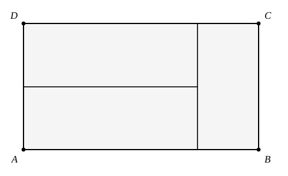

## Statement

Trois rectangles identiques forment ensemble le rectangle $ABCD$, comme sur la figure. Le côté le plus court d'un petit rectangle a pour longueur $5$.

Quel est le périmètre du rectangle $ABCD$ ?

## Hints

1. Sur la figure, les deux rectangles de gauche sont posés l'un sur l'autre, couchés. Quelle est la hauteur de $ABCD$ ?
2. Le rectangle de droite est debout et occupe toute la hauteur de $ABCD$. Que vaut donc sa longueur ?
3. Tu connais maintenant les deux dimensions d'un petit rectangle : $5$ et sa longueur. Reconstitue la largeur de $ABCD$.

## Solution

**La hauteur de $ABCD$.**

À gauche, les deux petits rectangles sont couchés l'un sur l'autre. Chacun présente son petit côté à la verticale, c'est-à-dire $5$. La hauteur de $ABCD$ vaut donc

$$5 + 5 = 10 .$$

**La longueur d'un petit rectangle.**

Le troisième rectangle est debout à droite et occupe toute la hauteur de $ABCD$. Son grand côté mesure donc $10$ : c'est la longueur d'un petit rectangle. Un petit rectangle mesure donc $5$ sur $10$.

**La largeur de $ABCD$.**

En bas, on traverse d'abord un rectangle couché, qui présente son grand côté, $10$, puis le rectangle debout, qui présente son petit côté, $5$. La largeur de $ABCD$ vaut

$$10 + 5 = 15 .$$

**On conclut.**

Le rectangle $ABCD$ mesure $15$ sur $10$, donc son périmètre vaut

$$2 \times (15 + 10) = 50 .$$

## Going further

Quelle est l'aire de $ABCD$ ? Et quelle fraction de cette aire occupe un petit rectangle ?
