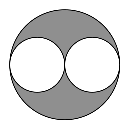

## Statement

Dans la figure suivante, le diamètre de chaque petit cercle est égal au rayon du grand cercle.

Les deux petits disques ont ensemble une aire de $1\ \mathrm{cm}^2$. Quelle est l'aire de la région grise ?

## Hints

1. Donne un nom au rayon du grand cercle, par exemple $R$. Que vaut alors le rayon d'un petit cercle ?
2. Écris l'aire d'un petit disque en fonction de $R$, puis l'aire du grand disque.
3. Quelle fraction du grand disque les deux petits disques occupent-ils ensemble ?

## Solution

**On écrit les deux aires.**

Notons $R$ le rayon du grand cercle. Le diamètre d'un petit cercle vaut $R$, donc son rayon vaut $\dfrac{R}{2}$.

L'aire d'un petit disque vaut

$$\pi \times \left(\frac{R}{2}\right)^2 = \frac{\pi R^2}{4} ,$$

et les deux petits disques ont ensemble une aire de

$$2 \times \frac{\pi R^2}{4} = \frac{\pi R^2}{2} .$$

Or l'aire du grand disque vaut $\pi R^2$.

**On conclut.**

Les deux petits disques occupent donc exactement la moitié du grand disque. Comme ils ont ensemble une aire de $1\ \mathrm{cm}^2$, le grand disque a une aire de $2\ \mathrm{cm}^2$, et la région grise est ce qu'il en reste :

$$2 - 1 = 1 .$$

L'aire de la région grise vaut $1\ \mathrm{cm}^2$, exactement la même que celle des deux petits disques réunis.
