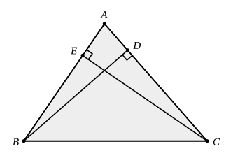

## Statement

$ABC$ est un triangle dont les trois angles sont aigus. La hauteur issue de $B$ coupe le côté
$[AC]$ en $D$, et la hauteur issue de $C$ coupe le côté $[AB]$ en $E$.

Montrer que $\widehat{ABD} = \widehat{ACE}$.

## Hints

1. Combien y a-t-il d'angles droits sur la figure ? Où sont-ils ?
2. Regarde le triangle $ABD$ : il est rectangle en $D$. Que vaut la somme de ses deux angles aigus ?
3. Fais la même chose avec le triangle $ACE$. Les deux calculs font apparaître le même angle.

## Solution

**L'idée : les deux angles se calculent tous les deux à partir de l'angle $\widehat{BAC}$.**

Posons $\alpha = \widehat{BAC}$.

**Le triangle $ABD$.** La hauteur issue de $B$ est perpendiculaire à $(AC)$, donc le triangle
$ABD$ est rectangle en $D$. Ses deux angles aigus sont complémentaires :

$$\widehat{ABD} = 90^\circ - \widehat{BAD}.$$

Le point $D$ est sur le côté $[AC]$, donc l'angle $\widehat{BAD}$ est l'angle $\widehat{BAC}$
lui-même. Ainsi $\widehat{ABD} = 90^\circ - \alpha$.

**Le triangle $ACE$.** De la même façon, la hauteur issue de $C$ est perpendiculaire à $(AB)$,
donc le triangle $ACE$ est rectangle en $E$ et

$$\widehat{ACE} = 90^\circ - \widehat{CAE}.$$

Le point $E$ est sur le côté $[AB]$, donc $\widehat{CAE} = \widehat{BAC} = \alpha$, et
$\widehat{ACE} = 90^\circ - \alpha$.

**Conclusion.** Les deux angles valent tous les deux $90^\circ - \alpha$, donc

$$\widehat{ABD} = \widehat{ACE}.$$

## Going further

Les deux hauteurs se coupent en un point $H$. Exprimer l'angle $\widehat{BHC}$ en fonction de
$\alpha$.
