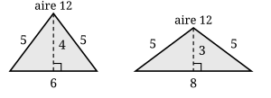

## Statement

Comparer les aires des deux triangles suivants :

- le premier a pour côtés $5$, $5$ et $6$ ;
- le second a pour côtés $5$, $5$ et $8$.

## Hints

1. Les deux triangles sont isocèles. Trace dans chacun la hauteur issue du sommet principal, celui d'où partent les deux côtés de même longueur.
2. Dans un triangle isocèle, cette hauteur coupe la base en son milieu. Quelle est alors la longueur de chaque demi-base ?
3. La hauteur partage le triangle en deux triangles rectangles. Tu connais l'hypoténuse et un côté de l'angle droit : le théorème de Pythagore te donne la hauteur.

## Solution

**Le premier triangle : côtés $5$, $5$ et $6$.**

Il est isocèle, sa base mesure $6$. Traçons la hauteur issue du sommet principal. Dans un triangle isocèle, cette hauteur tombe au milieu de la base, donc elle la coupe en deux morceaux de $3$.

On obtient un triangle rectangle d'hypoténuse $5$ et dont un côté de l'angle droit mesure $3$. Notons $h$ la hauteur. Le théorème de Pythagore donne

$$3^2 + h^2 = 5^2 \quad \text{donc} \quad h^2 = 25 - 9 = 16 \quad \text{donc} \quad h = 4$$

L'aire du premier triangle vaut donc

$$\frac{6 \times 4}{2} = 12$$

**Le second triangle : côtés $5$, $5$ et $8$.**

Même travail. La base mesure $8$, la hauteur la coupe en deux morceaux de $4$. Notons $h'$ cette hauteur :

$$4^2 + h'^2 = 5^2 \quad \text{donc} \quad h'^2 = 25 - 16 = 9 \quad \text{donc} \quad h' = 3$$

L'aire du second triangle vaut donc

$$\frac{8 \times 3}{2} = 12$$

**Conclusion.**

Les deux triangles ont la même aire, qui vaut $12$.

*Pourquoi ce n'est pas un hasard.* Dans les deux cas, la hauteur a découpé le triangle en deux triangles rectangles de côtés $3$, $4$ et $5$. Les deux triangles de l'énoncé sont donc faits des mêmes briques : deux triangles rectangles $3$–$4$–$5$. Seulement, dans le premier on les colle par le côté de longueur $4$, et dans le second par le côté de longueur $3$. Les briques sont les mêmes, l'aire totale aussi.

## Going further

1. Les deux triangles ont la même aire. Ont-ils le même périmètre ?
2. Prends n'importe quel triangle rectangle dont les côtés de l'angle droit mesurent $p$ et $q$. Colle deux copies de ce triangle par le côté $p$, puis deux copies par le côté $q$ : tu obtiens deux triangles isocèles. Montre que leurs aires sont toujours égales, et qu'elles valent $p \times q$.
3. Parmi tous les triangles de côtés $5$, $5$ et $x$, lequel a la plus grande aire ? (Indication : prends comme base un des côtés de longueur $5$, et demande-toi quelle est la plus grande hauteur possible.)
