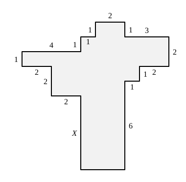

## Statement

Dans la figure suivante, tous les angles sont droits et les longueurs sont données en centimètres.

Quelle est la longueur de $X$, en centimètres ?

## Hints

1. On ne connaît pas toutes les longueurs de la figure, et pourtant la question a une réponse. C'est qu'une partie seulement des données sert. Lesquelles ?
2. Ne regarde que les côtés verticaux, et oublie les horizontaux.
3. Fais le tour complet du contour, en partant d'un coin et en revenant à ce même coin.
4. Pendant ce tour, tu es parfois monté et parfois descendu, et tu es revenu à la même hauteur qu'au départ. Que peux-tu dire de la somme des montées et de la somme des descentes ?

## Solution

**L'idée : faire le tour de la figure.**

Tous les angles sont droits, donc chaque côté est soit horizontal, soit vertical. Partons du coin situé à l'extrémité gauche du côté de longueur $4$, tout en haut à gauche, et parcourons le contour dans le sens des aiguilles d'une montre. À la fin du tour, nous revenons exactement à notre point de départ, donc à la même hauteur qu'au départ.

**On relève les montées et les descentes.**

En tournant dans ce sens, les côtés verticaux se présentent dans cet ordre :

- on monte de $1$, puis on monte encore de $1$ (les deux petites marches en haut à gauche) ;
- on descend de $1$, puis de $2$, puis de $1$, puis de $6$ (tout le côté droit de la figure, jusqu'au bas) ;
- on remonte de $X$, puis de $2$, puis de $1$ (le retour, à gauche).

**On conclut.**

Tout ce qui a été monté a été redescendu, donc la somme des montées est égale à la somme des descentes :

$$1 + 1 + X + 2 + 1 = 1 + 2 + 1 + 6 .$$

C'est-à-dire

$$X + 5 = 10 , \qquad \text{donc} \qquad X = 5 .$$

La longueur cherchée vaut $5$ centimètres.

## Going further

Le même raisonnement avec les côtés horizontaux donne la longueur du côté du bas, qui n'est pas écrite sur la figure : en allant vers la droite on parcourt $4 + 1 + 2 + 3 = 10$, et en revenant vers la gauche on parcourt $2 + 1 + 2 + 2 = 7$ plus le côté du bas. Ce côté mesure donc $10 - 7 = 3$ centimètres.
