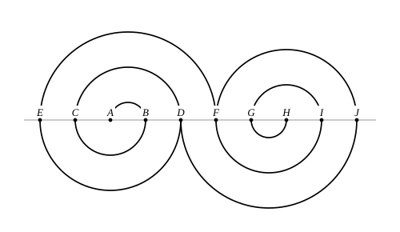

## Statement

En grande section de maternelle, le professeur fait réaliser le motif ci-dessous avec de la laine collée sur des demi-cercles dessinés à l'avance.

Les points $A$, $B$, $C$, $D$, $E$, $F$, $G$, $H$, $I$, $J$ sont alignés, et deux points voisins sont toujours distants de $2$ cm : en particulier $AB = 2$ cm. Chaque demi-cercle du motif a pour diamètre un segment dont les deux extrémités sont deux de ces points.

Le professeur donne à chaque enfant un morceau de laine d'une longueur de $1$ m. Cela sera-t-il suffisant ?

## Hints

1. Un demi-cercle de rayon $r$ a pour longueur $\pi r$, la moitié du périmètre du cercle entier.
2. Il faut donc connaître le rayon de chacun des demi-cercles du motif. Repère les deux extrémités de chaque demi-cercle : ce sont deux des points marqués.
3. Commence par l'enroulement de gauche, en partant du plus petit demi-cercle : son diamètre est $[AB]$, puis vient $[BC]$, puis $[CD]$, puis $[DE]$, puis $[EF]$. Quelles sont ces longueurs ?
4. Additionne tous les rayons **avant** de multiplier par $\pi$ : c'est plus rapide et plus sûr.

## Solution

**On lit les rayons sur la figure.**

Les points se suivent sur la droite dans cet ordre : $E$, $C$, $A$, $B$, $D$, $F$, $G$, $H$, $I$, $J$, et deux points voisins sont distants de $2$ cm.

Le motif est fait de deux enroulements.

L'enroulement de gauche part de $A$ et tourne en s'agrandissant :

| diamètre | $[AB]$ | $[BC]$ | $[CD]$ | $[DE]$ | $[EF]$ |
|---|---|---|---|---|---|
| longueur du diamètre | $2$ | $4$ | $6$ | $8$ | $10$ |
| rayon | $1$ | $2$ | $3$ | $4$ | $5$ |

L'enroulement de droite est le même, retourné : ses diamètres sont $[HG]$, $[GI]$, $[IF]$, $[FJ]$ et $[JD]$, de longueurs $2$, $4$, $6$, $8$ et $10$, donc de rayons $1$, $2$, $3$, $4$ et $5$.

**On additionne.**

Chaque demi-cercle de rayon $r$ mesure $\pi r$. La longueur totale de laine vaut donc

$$\pi \times (1 + 2 + 3 + 4 + 5) + \pi \times (1 + 2 + 3 + 4 + 5) = \pi \times 15 + \pi \times 15 = 30\pi .$$

**On conclut.**

$$30\pi \approx \text{94,2 cm}.$$

Comme $\text{94,2} < 100$, un morceau de laine de $1$ m suffit. Mais il ne reste qu'environ $6$ cm : le professeur a bien calculé son coup.

## Going further

Si le motif comportait un enroulement de plus de chaque côté, c'est-à-dire deux demi-cercles supplémentaires de rayon $6$, la laine suffirait-elle encore ?
