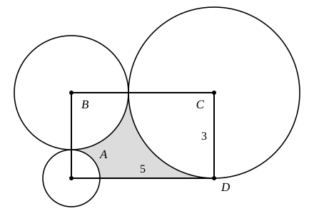

## Statement

Le rectangle $ABCD$ a pour côtés $CD = 3$ et $DA = 5$. Un cercle de rayon $1$ a son centre en $A$, un cercle de rayon $2$ a son centre en $B$, et un cercle de rayon $3$ a son centre en $C$.

Quelle est l'aire de la partie du rectangle qui ne se trouve à l'intérieur d'aucun des trois cercles ?

## Hints

1. Chaque cercle a son centre sur un sommet du rectangle, et les deux côtés qui partent de ce sommet forment un angle droit. Quelle part de chaque disque se trouve alors à l'intérieur du rectangle ?
2. Vérifie que chacun de ces quarts de disque tient tout entier dans le rectangle : compare son rayon aux deux côtés qui partent de son centre.
3. Vérifie aussi que deux de ces quarts de disque ne se chevauchent jamais : compare la distance entre deux centres à la somme des deux rayons.
4. Il ne reste plus qu'à retrancher les trois quarts de disque de l'aire du rectangle.

## Solution

**L'aire du rectangle.**

$$5 \times 3 = 15 .$$

**Chaque disque n'entre dans le rectangle que par un quart.**

Le centre de chaque cercle est un sommet du rectangle. Les deux côtés qui partent de ce sommet forment un angle droit, c'est-à-dire un quart de tour : la partie du disque qui est dans le rectangle est donc un quart de disque, à condition qu'il ne déborde pas.

Vérifions qu'aucun ne déborde :

- le disque de centre $A$ et de rayon $1$ : de $A$ partent les côtés $AB = 3$ et $AD = 5$, tous deux plus grands que $1$ ;
- le disque de centre $B$ et de rayon $2$ : de $B$ partent $BA = 3$ et $BC = 5$, tous deux plus grands que $2$ ;
- le disque de centre $C$ et de rayon $3$ : de $C$ partent $CB = 5$ et $CD = 3$. Le quart de disque touche $D$ tout juste, sans dépasser.

**Deux quarts de disque ne se chevauchent jamais.**

- $A$ et $B$ : la distance $AB$ vaut $3$, et $1 + 2 = 3$. Les deux cercles se touchent sans se recouvrir.
- $B$ et $C$ : la distance $BC$ vaut $5$, et $2 + 3 = 5$. Même chose.
- $A$ et $C$ : si les deux disques avaient un point commun, on aurait $AC \leqslant 1 + 3 = 4$. Or $[AC]$ est une diagonale du rectangle, donc $AC$ est plus grand que le côté $AD = 5$. Ils sont donc bien séparés.

**On calcule.**

Les trois quarts de disque ont pour aires

$$\frac{\pi \times 1^2}{4} = \frac{\pi}{4} , \qquad \frac{\pi \times 2^2}{4} = \pi , \qquad \frac{\pi \times 3^2}{4} = \frac{9\pi}{4} ,$$

soit au total

$$\frac{\pi}{4} + \pi + \frac{9\pi}{4} = \frac{\pi + 4\pi + 9\pi}{4} = \frac{14\pi}{4} = \frac{7\pi}{2} .$$

**On conclut.**

L'aire cherchée vaut

$$15 - \frac{7\pi}{2} \approx 15 - \text{11,0} \approx \text{4,0} .$$

La partie grisée est donc toute petite : environ $4$, alors que le rectangle en vaut $15$.
