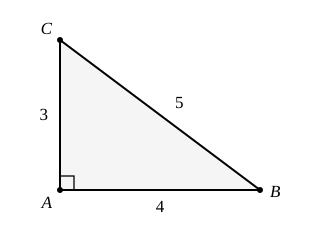

## Statement

Le triangle $ABC$ est rectangle en $A$, avec $AC = 3$, $AB = 4$ et $BC = 5$.

On choisit le point $D$ sur le segment $[BC]$ de façon que les triangles $ABD$ et $ACD$ aient le même périmètre.

Quelle est l'aire du triangle $ABD$ ?

## Hints

1. Le segment $[AD]$ est un côté des deux triangles à la fois. Écris les deux périmètres et compare-les.
2. Après avoir enlevé ce qui est commun, il reste $AB + BD = AC + CD$, c'est-à-dire $4 + BD = 3 + CD$. Et tu sais aussi que $BD + CD = 5$.
3. Pour l'aire, ne cherche pas à calculer la hauteur : les triangles $ABD$ et $ABC$ ont le même sommet $A$, et leurs bases $[BD]$ et $[BC]$ sont portées par la même droite.

## Solution

**On place $D$.**

Le segment $[AD]$ est un côté du triangle $ABD$ et un côté du triangle $ACD$. Les deux périmètres valent

$$AB + BD + DA = 4 + BD + DA \qquad \text{et} \qquad AC + CD + DA = 3 + CD + DA .$$

Ils sont égaux, et on peut enlever $DA$ des deux côtés :

$$4 + BD = 3 + CD , \qquad \text{donc} \qquad CD = BD + 1 .$$

Comme $D$ est sur $[BC]$, on a aussi $BD + CD = BC = 5$. En remplaçant :

$$BD + (BD + 1) = 5 , \qquad \text{donc} \qquad 2 \times BD = 4 , \qquad \text{donc} \qquad BD = 2 .$$

Le point $D$ est donc à $2$ de $B$ et à $3$ de $C$.

**On calcule l'aire.**

Le triangle $ABC$ est rectangle en $A$, donc son aire vaut

$$\frac{AB \times AC}{2} = \frac{4 \times 3}{2} = 6 .$$

Les triangles $ABD$ et $ABC$ ont le même sommet $A$, et leurs bases $[BD]$ et $[BC]$ sont sur la même droite : ils ont donc la même hauteur issue de $A$. Leurs aires sont alors proportionnelles à leurs bases :

$$\frac{\text{aire}(ABD)}{\text{aire}(ABC)} = \frac{BD}{BC} = \frac{2}{5} .$$

**On conclut.**

$$\text{aire}(ABD) = \frac{2}{5} \times 6 = \frac{12}{5} = \text{2,4} .$$

## Going further

Vérifier que les deux périmètres sont bien égaux : ils valent chacun $6 + AD$, et $AD$ est la même longueur dans les deux triangles. Quelle est l'aire de $ACD$ ? La somme des deux aires doit valoir $6$.
