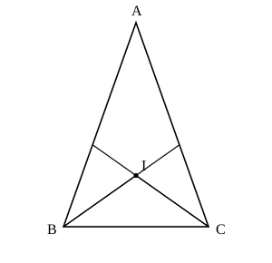

## Statement

$ABC$ est un triangle isocèle en $A$, c'est-à-dire que $AB = AC$. La bissectrice de l'angle $\widehat{B}$ et la bissectrice de l'angle $\widehat{C}$ se coupent en un point $I$.

On sait que l'angle $\widehat{BIC}$ mesure cinq fois l'angle $\widehat{A}$.

Calculer les mesures des trois angles $\widehat{A}$, $\widehat{B}$ et $\widehat{C}$.

## Hints

1. Appelle $a$ la mesure en degrés de l'angle $\widehat{A}$. Exprime $\widehat{B}$ et $\widehat{C}$ en fonction de $a$ : le triangle est isocèle en $A$, et la somme des trois angles vaut $180°$.
2. Dans le triangle $BIC$, tu connais deux angles : ce sont les moitiés de $\widehat{B}$ et de $\widehat{C}$.
3. Écris la somme des angles du triangle $BIC$ : tu obtiens $\widehat{BIC}$ en fonction de $a$. L'énoncé se traduit alors par une équation d'inconnue $a$.

## Solution

Appelons $a$ la mesure en degrés de l'angle $\widehat{A}$.

**Les angles à la base.** Le triangle est isocèle en $A$, donc $\widehat{B} = \widehat{C}$. La somme des trois angles vaut $180°$ :

$$a + 2 \times \widehat{B} = 180°, \qquad \text{donc} \qquad \widehat{B} = \widehat{C} = 90° - \frac{a}{2}.$$

**L'angle $\widehat{BIC}$.** Les demi-droites $[BI)$ et $[CI)$ sont les bissectrices des angles $\widehat{B}$ et $\widehat{C}$, donc dans le triangle $BIC$ :

$$\widehat{IBC} = \frac{\widehat{B}}{2} = 45° - \frac{a}{4}, \qquad \widehat{ICB} = \frac{\widehat{C}}{2} = 45° - \frac{a}{4}.$$

La somme des angles du triangle $BIC$ donne

$$\widehat{BIC} = 180° - 2 \times \left(45° - \frac{a}{4}\right) = 180° - 90° + \frac{a}{2} = 90° + \frac{a}{2}.$$

**L'équation.** L'énoncé dit que $\widehat{BIC} = 5a$, donc

$$90° + \frac{a}{2} = 5a.$$

On regroupe les termes en $a$ :

$$90° = 5a - \frac{a}{2} = \frac{9a}{2}, \qquad \text{donc} \qquad a = \frac{2 \times 90°}{9} = 20°.$$

**Les trois angles.**

$$\widehat{A} = 20°, \qquad \widehat{B} = \widehat{C} = 90° - 10° = 80°.$$

**Vérification.** Avec ces valeurs, les demi-angles en $B$ et en $C$ valent $40°$, donc dans le triangle $BIC$

$$\widehat{BIC} = 180° - 40° - 40° = 100° = 5 \times 20°.$$

Tout est cohérent.

## Going further

Reprendre le calcul sans supposer le triangle isocèle : dans n'importe quel triangle $ABC$, si $I$ est le point de rencontre des bissectrices des angles $\widehat{B}$ et $\widehat{C}$, montrer que

$$\widehat{BIC} = 90° + \frac{\widehat{A}}{2}.$$

En particulier, cet angle est toujours obtus.
