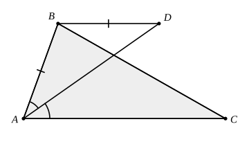

## Statement

$ABC$ est un triangle et $D$ est un point de la bissectrice de l'angle $\widehat{BAC}$.

Montrer que si $(BD)$ est parallèle à $(AC)$, alors $AB = BD$.

## Hints

1. Pour démontrer que $AB = BD$, il suffit de montrer que le triangle $ABD$ est isocèle en $B$,
   c'est-à-dire que ses angles en $A$ et en $D$ sont égaux.
2. La droite $(AD)$ coupe les deux droites parallèles $(BD)$ et $(AC)$. Quelle paire d'angles
   cela fait-il apparaître ?
3. L'angle $\widehat{ADB}$ et l'angle $\widehat{DAC}$ sont alternes-internes. Et que dit la
   bissectrice sur $\widehat{DAC}$ ?

## Solution

**L'idée : faire voyager l'angle $\widehat{DAC}$ le long de la parallèle.**

**Étape 1. La bissectrice.** Comme $D$ est sur la bissectrice de l'angle $\widehat{BAC}$,

$$\widehat{BAD} = \widehat{DAC}.$$

**Étape 2. La parallèle.** La droite $(AD)$ coupe les deux droites parallèles $(BD)$ et $(AC)$.
Les angles $\widehat{ADB}$ et $\widehat{DAC}$ sont alternes-internes (les points $B$ et $C$
sont de part et d'autre de la droite $(AD)$, puisque celle-ci est à l'intérieur de l'angle
$\widehat{BAC}$). Deux angles alternes-internes formés par deux parallèles sont égaux :

$$\widehat{ADB} = \widehat{DAC}.$$

**Étape 3. On recolle.** En mettant les deux égalités bout à bout :

$$\widehat{ADB} = \widehat{DAC} = \widehat{BAD}.$$

Dans le triangle $ABD$, les angles en $A$ et en $D$ sont donc égaux : ce triangle est isocèle,
et les deux côtés égaux sont ceux qui partent du troisième sommet $B$.

**Conclusion.** $BA = BD$, c'est-à-dire $AB = BD$.

## Going further

Le point $D$ n'est pas n'importe où sur la bissectrice : la condition $(BD) \parallel (AC)$ le
fixe complètement. Montrer que le quadrilatère $ABDC$ n'est jamais un parallélogramme, sauf
dans un cas particulier que l'on précisera.
