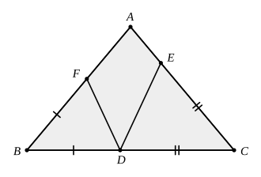

## Statement

$ABC$ est un triangle isocèle en $A$, c'est-à-dire $AB = AC$, et $\widehat{BAC} = 80^\circ$.

On place trois points : $D$ sur $[BC]$, $E$ sur $[CA]$ et $F$ sur $[AB]$, de façon que

$$CE = CD \qquad \text{et} \qquad BF = BD.$$

Calculer la mesure de l'angle $\widehat{EDF}$.

## Hints

1. Commence par calculer les angles $\widehat{ABC}$ et $\widehat{ACB}$.
2. Le triangle $BDF$ est isocèle, et tu connais son angle au sommet. Calcule
   $\widehat{BDF}$.
3. Recommence avec le triangle $CDE$.
4. Les points $B$, $D$, $C$ sont alignés : les trois angles de sommet $D$ situés du même côté
   de la droite $(BC)$ ont une somme connue.

## Solution

**L'idée : calculer les deux angles voisins de $\widehat{EDF}$, puis compléter à $180^\circ$.**

**Étape 1. Les angles du triangle $ABC$.** Le triangle est isocèle en $A$, ses angles à la base
sont égaux, et leur somme vaut $180^\circ - 80^\circ = 100^\circ$ :

$$\widehat{ABC} = \widehat{ACB} = \frac{100^\circ}{2} = 50^\circ.$$

**Étape 2. Le triangle $BDF$.** Il est isocèle en $B$, car $BF = BD$. Son angle au sommet est
$\widehat{FBD} = \widehat{ABC} = 50^\circ$, donc ses deux angles à la base valent

$$\widehat{BDF} = \widehat{BFD} = \frac{180^\circ - 50^\circ}{2} = 65^\circ.$$

**Étape 3. Le triangle $CDE$.** Il est isocèle en $C$, car $CE = CD$. Son angle au sommet est
$\widehat{ECD} = \widehat{ACB} = 50^\circ$, donc

$$\widehat{CDE} = \widehat{CED} = \frac{180^\circ - 50^\circ}{2} = 65^\circ.$$

**Étape 4. On tourne autour de $D$.** Les points $B$, $D$, $C$ sont alignés, et les points $F$
et $E$ sont du même côté de la droite $(BC)$. Les trois angles $\widehat{BDF}$,
$\widehat{FDE}$ et $\widehat{EDC}$ se suivent et remplissent un demi-tour :

$$\widehat{BDF} + \widehat{FDE} + \widehat{EDC} = 180^\circ.$$

D'où

$$\widehat{EDF} = 180^\circ - 65^\circ - 65^\circ = 50^\circ.$$

**Conclusion.** L'angle $\widehat{EDF}$ mesure $50^\circ$. Remarquons que le point $D$ n'a
jamais servi ailleurs que comme point de $[BC]$ : la réponse est la même où que l'on place $D$
sur le côté $[BC]$.

## Going further

Reprendre le calcul en remplaçant $80^\circ$ par une mesure quelconque $a$ pour l'angle
$\widehat{BAC}$. Montrer que $\widehat{EDF} = 90^\circ - \dfrac{a}{2}$. Pour quelle valeur de
$a$ l'angle $\widehat{EDF}$ est-il droit ?
