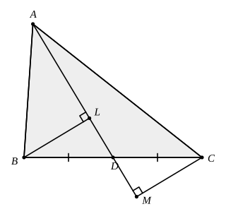

## Statement

$ABC$ est un triangle et $D$ est le milieu du côté $[BC]$. On trace la droite $(AD)$, puis les
projetés orthogonaux $L$ et $M$ des points $B$ et $C$ sur cette droite.

Montrer que $BL = CM$.

## Hints

1. Les longueurs $BL$ et $CM$ sont des côtés de deux petits triangles. Lesquels ?
2. Regarde les triangles $BLD$ et $CMD$. Que sais-tu de $BD$ et de $DC$ ? Et de leurs angles
   en $L$ et en $M$ ?
3. Les points $B$, $D$, $C$ sont alignés, et les points $L$, $D$, $M$ aussi. Que peut-on en
   dire des angles $\widehat{BDL}$ et $\widehat{CDM}$ ?

## Solution

**L'idée : les deux petits triangles rectangles $BLD$ et $CMD$ sont superposables.**

Comparons les triangles $BLD$ et $CMD$ :

- $BD = DC$, puisque $D$ est le milieu de $[BC]$ ;
- $\widehat{BLD} = \widehat{CMD} = 90^\circ$, car $L$ et $M$ sont les projetés orthogonaux de
  $B$ et de $C$ sur la droite $(AD)$ ;
- $\widehat{BDL} = \widehat{CDM}$ : ces deux angles sont opposés par le sommet. En effet, $D$
  est sur la droite $(BC)$ entre $B$ et $C$, et $D$ est aussi sur la droite $(LM)$, qui n'est
  autre que la droite $(AD)$.

Les deux triangles ont donc un côté égal et les deux angles qui le touchent égaux : ils sont
superposables. En particulier les côtés qui se correspondent sont égaux, et

$$BL = CM.$$

**Un cas particulier.** Si la droite $(AD)$ est perpendiculaire à $(BC)$, les points $L$, $M$
et $D$ sont confondus, et l'égalité $BL = CM$ reste vraie : les deux longueurs valent alors
$BD = DC$.

**Conclusion.** Le milieu de $[BC]$ se trouve toujours à égale distance « en biais » des deux
sommets $B$ et $C$ : $BL = CM$.

## Going further

Montrer que $BL$ et $CM$ sont non seulement égales, mais que le quadrilatère $BLCM$ est un
parallélogramme (lorsque $L \ne M$).
