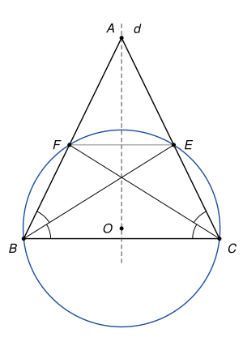

## Statement

Soit $ABC$ un triangle isocèle en $A$. La bissectrice de l'angle $\widehat{ABC}$ coupe le côté $[AC]$ en un point $E$, et la bissectrice de l'angle $\widehat{ACB}$ coupe le côté $[AB]$ en un point $F$.

Montrer que les quatre points $B$, $C$, $E$ et $F$ sont sur un même cercle.

![Le triangle ABC isocèle en A et les bissectrices [BE] et [CF]](10273-figure-1.svg)

## Hints

1. Un triangle isocèle a un axe de symétrie. Lequel ? Que devient la bissectrice issue de $B$ quand on lui applique cette symétrie ?
2. Montrer que les points $E$ et $F$ sont symétriques l'un de l'autre par rapport à cet axe.
3. Tracez le cercle qui passe par $B$, $C$ et $F$. Où est son centre ? Que peut-on dire de sa distance au point $E$ ?

## Solution

*Rappel.* Dans un triangle $ABC$ isocèle en $A$, on a $AB = AC$, donc le point $A$ est sur la médiatrice $d$ du segment $[BC]$. La symétrie par rapport à la droite $d$ échange $B$ et $C$ et laisse $A$ à sa place : c'est un axe de symétrie du triangle. Une symétrie axiale conserve les longueurs et les angles.

On note $s$ la symétrie par rapport à la droite $d$.

**Étape 1 : $E$ et $F$ sont symétriques par rapport à $d$.** La symétrie $s$ échange $B$ et $C$ et fixe $A$. Elle envoie donc la droite $(AC)$ sur la droite $(AB)$, et l'angle $\widehat{ABC}$ sur l'angle $\widehat{ACB}$.

La bissectrice $[BE)$ partage l'angle $\widehat{ABC}$ en deux angles égaux. Son image est une demi-droite issue de $C$ qui partage l'angle $\widehat{ACB}$ en deux angles égaux, puisque $s$ conserve les angles : c'est la bissectrice de $\widehat{ACB}$.

Le point $E$ est à la fois sur la bissectrice issue de $B$ et sur la droite $(AC)$. Son image $s(E)$ est donc à la fois sur la bissectrice issue de $C$ et sur la droite $(AB)$ : c'est le point $F$. Ainsi $s(E) = F$.

**Étape 2 : le cercle qui passe par $B$, $C$ et $F$.** Le point $F$ est sur le côté $[AB]$ et différent de $B$, donc les points $B$, $C$, $F$ ne sont pas alignés. Ils sont sur un cercle, le cercle circonscrit au triangle $BCF$. On note $O$ son centre.

Comme $OB = OC$, le point $O$ est sur la médiatrice de $[BC]$, c'est-à-dire sur l'axe $d$. Il est donc fixé par la symétrie : $s(O) = O$.

**Étape 3 : le point $E$ est sur ce cercle.** La symétrie $s$ envoie $O$ sur $O$ et $F$ sur $E$. Elle conserve les longueurs, donc

$$OE = OF.$$

Finalement $OE = OF = OB = OC$ : le point $E$ est lui aussi à la distance $OB$ du point $O$.

**Conclusion.** Les quatre points $B$, $C$, $E$ et $F$ sont sur le cercle de centre $O$ qui passe par $B$.

*Remarques.*

- Les droites $(EF)$ et $(BC)$ sont toutes les deux perpendiculaires à l'axe $d$, donc parallèles : $BCEF$ est un trapèze isocèle. La preuve ci-dessus montre plus généralement qu'un trapèze isocèle a toujours ses quatre sommets sur un même cercle.
- Le corrigé officiel procède autrement : les angles $\widehat{FBE}$ et $\widehat{FCE}$ sont égaux, car ce sont deux moitiés d'angles égaux, et la réciproque du théorème de l'angle inscrit (vue en seconde) permet de conclure.
