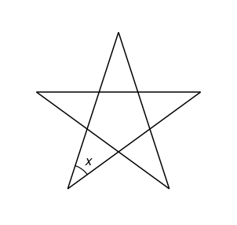

## Statement

On trace une étoile régulière à cinq branches : on place cinq points régulièrement espacés sur un cercle, et on relie chacun d'eux aux deux points qui ne sont pas ses voisins.

Déterminer la mesure de l'angle $x$ marqué à l'une des pointes.

## Hints

1. Au centre de l'étoile, les cinq segments délimitent un pentagone. Comme l'étoile est régulière, ses cinq angles sont égaux.
2. Découpe ce pentagone en triangles à l'aide de deux diagonales issues d'un même sommet pour trouver la somme de ses angles.
3. Chaque pointe de l'étoile est un triangle posé sur un côté du pentagone. Que valent ses deux angles à la base ?

## Solution

**Le pentagone du milieu.** Les cinq segments de l'étoile délimitent, au centre, un pentagone. L'étoile est régulière : en la tournant d'un cinquième de tour autour du centre du cercle, on la retrouve exactement. Les cinq angles de ce pentagone sont donc égaux.

**La somme des angles d'un pentagone.** En traçant les deux diagonales issues d'un même sommet, on découpe le pentagone en $3$ triangles. Les angles de ces trois triangles forment exactement les angles du pentagone, donc la somme des angles du pentagone vaut
$$3 \times 180^\circ = 540^\circ .$$
Chacun de ses cinq angles mesure donc
$$\frac{540^\circ}{5} = 108^\circ .$$

**Une pointe.** Une pointe de l'étoile est un triangle dont la base est un côté du pentagone, et dont les deux autres côtés prolongent les côtés voisins du pentagone. Un angle à la base de ce triangle et l'angle du pentagone qui est à côté forment donc un angle plat :
$$\text{angle à la base} = 180^\circ - 108^\circ = 72^\circ .$$
La somme des angles du triangle de la pointe vaut $180^\circ$, donc
$$x = 180^\circ - 2 \times 72^\circ = 36^\circ .$$

**Une autre méthode : la promenade de la fourmi.** Une fourmi part du milieu d'un segment de l'étoile et suit les segments jusqu'à revenir à son point de départ, dans le même sens. À chacune des cinq pointes, elle tourne d'un angle de $180^\circ - x$. Pendant sa promenade, elle fait deux tours complets sur elle-même : on le voit en suivant du doigt la direction dans laquelle elle regarde, qui tourne deux fois autour du centre. Ainsi
$$5 \times (180^\circ - x) = 2 \times 360^\circ = 720^\circ, \qquad 180^\circ - x = 144^\circ, \qquad x = 36^\circ .$$

**Conclusion.** L'angle à chaque pointe d'une étoile régulière à cinq branches mesure $36^\circ$.

## Going further

1. Montrer que la somme des cinq angles aux pointes vaut $180^\circ$ même pour une étoile **non régulière**, tracée à partir de cinq points quelconques (c'est l'exercice 0353).
2. On trace une étoile régulière à sept branches en reliant chacun des sept points à ceux qui sont à deux crans de lui. Quel est l'angle à chaque pointe ? Et en les reliant aux points à trois crans ?
