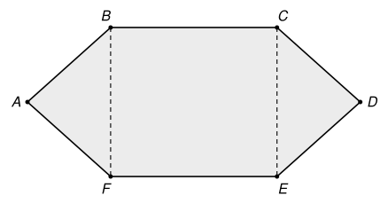

## Statement

Dans l'hexagone $ABCDEF$ ci-dessous, le quadrilatère $BCEF$ est un rectangle, et
$$AB = AF = CD = DE = 18, \qquad BC = EF = a, \qquad BF = 24 .$$

L'aire de l'hexagone $ABCDEF$ est égale à l'aire d'un rectangle de côtés $a$ et $36$.

Trouver la valeur de $a^2$.

## Hints

1. Découpe l'hexagone en trois morceaux : le rectangle $BCEF$ et deux triangles. Que sais-tu de ces deux triangles ?
2. Pour calculer l'aire du triangle $ABF$, il faut sa hauteur issue de $A$. Note $H$ le milieu de $[BF]$ : pourquoi la droite $(AH)$ est-elle perpendiculaire à $(BF)$ ?
3. Le théorème de Pythagore dans le triangle $ABH$ donne $AH^2$. Il n'est pas nécessaire de calculer $AH$ lui-même : écris l'égalité des aires et regarde ce qu'elle dit sur $a$ et $AH$.

## Solution

**Le découpage.** L'hexagone est formé du rectangle $BCEF$ et des deux triangles $ABF$ et $CDE$. Le rectangle a pour aire $24\,a$.

**Le triangle $ABF$.** Il est isocèle en $A$ car $AB = AF$. Notons $H$ le milieu de $[BF]$. Le point $A$ est à égale distance de $B$ et de $F$, donc il est sur la médiatrice de $[BF]$, qui passe par $H$ : la droite $(AH)$ est perpendiculaire à $(BF)$, et $[AH]$ est la hauteur du triangle issue de $A$.

On a $BH = \dfrac{24}{2} = 12$, et le triangle $ABH$ est rectangle en $H$. D'après le théorème de Pythagore,
$$AH^2 = AB^2 - BH^2 = 18^2 - 12^2 = 324 - 144 = 180 .$$
L'aire du triangle $ABF$ vaut
$$\frac{BF \times AH}{2} = \frac{24 \times AH}{2} = 12\,AH .$$

**Le triangle $CDE$.** Il a les mêmes longueurs de côtés, $18$, $18$ et $CE = BF = 24$ (côtés opposés d'un rectangle). Il a donc la même hauteur $AH$ et la même aire $12\,AH$.

**L'égalité des aires.** L'aire de l'hexagone vaut $24\,a + 12\,AH + 12\,AH = 24\,a + 24\,AH$. Elle est égale à $36\,a$, donc
$$24\,a + 24\,AH = 36\,a, \qquad 24\,AH = 12\,a, \qquad a = 2\,AH .$$

**Conclusion.** En élevant au carré,
$$a^2 = 4\,AH^2 = 4 \times 180 = 720 .$$

## Going further

1. Encadrer $a$ entre deux entiers consécutifs, sans calculatrice.
2. On garde $AB = AF = CD = DE = 18$ et $BF = 24$, mais on demande maintenant que l'aire de l'hexagone soit égale à l'aire d'un rectangle de côtés $a$ et $48$. Que vaut alors $a^2$ ?
