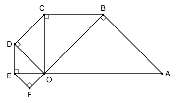

## Statement

Dans la figure ci-dessous, les triangles $ABO$, $BCO$, $CDO$, $DEO$ et $FEO$ sont rectangles isocèles, avec l'angle droit en $B$, $C$, $D$, $E$ et $F$ respectivement. On suppose que $OA = 8$ cm.

Déterminer l'aire du triangle $AOF$, en cm².

## Hints

1. Dans un triangle rectangle isocèle, si l'hypoténuse mesure $c$, que vaut le carré de chacun des deux autres côtés ?
2. Calcule de proche en proche $OB^2$, $OC^2$, $OD^2$, $OE^2$.
3. Additionne les angles en $O$ des triangles, de $\widehat{AOB}$ jusqu'à $\widehat{DOE}$. Où se trouve le point $E$ ?
4. Pour l'aire de $AOF$, prends $[OA]$ comme base. Quelle est la hauteur issue de $F$ ?

## Solution

**Un pas de la spirale.** Si un triangle est rectangle isocèle et que son hypoténuse mesure $c$, ses deux autres côtés ont la même longueur $\ell$, et le théorème de Pythagore donne $\ell^2 + \ell^2 = c^2$, soit $\ell^2 = \frac{c^2}{2}$. À chaque triangle, le carré de la longueur issue de $O$ est donc divisé par $2$ :

$$OA^2 = 64, \quad OB^2 = 32, \quad OC^2 = 16, \quad OD^2 = 8, \quad OE^2 = 4.$$

Donc $OE = 2$ cm, et dans le triangle $FEO$, d'hypoténuse $[OE]$, on a $FE = FO$ avec $FO^2 = 2$.

**Le point $E$ est sur la droite $(OA)$.** Dans un triangle rectangle isocèle, les deux angles aigus valent $45^\circ$. Donc

$$\widehat{AOB} = \widehat{BOC} = \widehat{COD} = \widehat{DOE} = 45^\circ,$$

et ces quatre angles, placés côte à côte autour de $O$, font en tout $4 \times 45^\circ = 180^\circ$. Les points $A$, $O$, $E$ sont donc alignés, avec $O$ entre $A$ et $E$.

**La hauteur issue de $F$.** Le triangle $FEO$ est rectangle isocèle en $F$ et son hypoténuse $[OE]$ est portée par la droite $(OA)$. Notons $H$ le milieu de $[OE]$. Dans un triangle isocèle, la médiane issue du sommet principal est aussi la hauteur, donc $(FH)$ est perpendiculaire à $(OA)$. De plus, dans un triangle rectangle, le milieu de l'hypoténuse est le centre du cercle circonscrit, donc $FH = HO = HE = \frac{OE}{2} = 1$ cm.

La hauteur du triangle $AOF$ issue de $F$ mesure donc $1$ cm.

**L'aire.** Avec la base $OA = 8$ cm et la hauteur $FH = 1$ cm,

$$\mathcal{A}(AOF) = \frac{8 \times 1}{2} = 4.$$

**Conclusion.** L'aire du triangle $AOF$ est $4$ cm².
