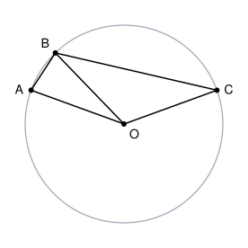

## Statement

Soient $A$, $B$ et $C$ trois points d'un cercle de centre $O$. Les points $A$, $O$ et $C$ ne sont pas alignés, et $B$ est sur le petit arc d'extrémités $A$ et $C$.

On sait que $\widehat{OBA} = 77^\circ$ et $\widehat{OBC} = 33^\circ$.

Combien mesure l'angle $\widehat{AOC}$ ?

## Hints

1. Fais une figure. Que valent les longueurs $OA$, $OB$ et $OC$ ?
2. Le triangle $AOB$ a deux côtés de même longueur. Quel est son troisième angle ?
3. Fais de même dans le triangle $BOC$, puis regarde comment les angles $\widehat{AOB}$ et $\widehat{BOC}$ se placent autour de $O$.

## Solution

**Dans le triangle $AOB$.** Les points $A$ et $B$ sont sur le cercle de centre $O$, donc $OA = OB$ : le triangle $AOB$ est isocèle en $O$. Ses angles à la base sont égaux :

$$\widehat{OAB} = \widehat{OBA} = 77^\circ.$$

La somme des angles d'un triangle vaut $180^\circ$, donc

$$\widehat{AOB} = 180^\circ - 2 \times 77^\circ = 180^\circ - 154^\circ = 26^\circ.$$

**Dans le triangle $BOC$.** De même $OB = OC$, donc le triangle $BOC$ est isocèle en $O$, et $\widehat{OCB} = \widehat{OBC} = 33^\circ$. Donc

$$\widehat{BOC} = 180^\circ - 2 \times 33^\circ = 180^\circ - 66^\circ = 114^\circ.$$

**Conclusion.** Comme $B$ est sur le petit arc d'extrémités $A$ et $C$, la demi-droite $[OB)$ est à l'intérieur de l'angle $\widehat{AOC}$, et cet angle est la somme des deux autres :

$$\widehat{AOC} = \widehat{AOB} + \widehat{BOC} = 26^\circ + 114^\circ = 140^\circ.$$

L'angle $\widehat{AOC}$ mesure $140^\circ$.

*Attention.* L'angle $\widehat{ABC}$, qui vaut $77^\circ + 33^\circ = 110^\circ$, n'est **pas** égal à l'angle $\widehat{AOC}$. C'est une erreur fréquente.

## Going further

Avec les mêmes données, calculer l'angle $\widehat{BAC}$. Vérifier ensuite que $\widehat{BAC}$ vaut la moitié de $\widehat{BOC}$.
