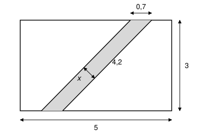

## Statement

On a tendu un ruban de largeur constante sur une face rectangulaire d'une boîte, comme sur la figure. La face mesure $5$ dm sur $3$ dm. Les deux bords du ruban sont des droites parallèles.

Sur le bord supérieur de la face, le ruban occupe une longueur de $\text{0,7}$ dm. L'un des bords du ruban mesure $\text{4,2}$ dm entre le bas et le haut de la face.

Calculer la largeur $x$ du ruban, c'est-à-dire la distance entre ses deux bords.

## Hints

1. Quelle est la forme de la partie grise ? Regarde quels côtés sont parallèles.
2. Il y a deux façons de calculer l'aire de cette figure, selon le côté que l'on choisit comme base.
3. Si la base est le côté de longueur $\text{0,7}$ posé sur le bord du haut, quelle est la hauteur correspondante ? Et si la base est le côté de longueur $\text{4,2}$ ?

## Solution

**La forme de la partie grise.** Les deux bords du ruban sont parallèles. Le bord du haut et le bord du bas de la face sont parallèles aussi. La partie grise a donc ses côtés opposés parallèles deux à deux : c'est un **parallélogramme**.

L'aire d'un parallélogramme vaut « base × hauteur », et on peut choisir n'importe quel côté comme base, à condition de prendre la hauteur qui lui correspond, c'est-à-dire la distance entre ce côté et le côté opposé.

**Premier calcul de l'aire.** Prenons pour base le côté posé sur le bord du haut. Sa longueur est $\text{0,7}$ dm. Le côté opposé est sur le bord du bas, et la distance entre le bord du haut et le bord du bas est la hauteur de la face, $3$ dm. Donc

$$\text{Aire} = \text{0,7} \times 3 = \text{2,1} \ \text{dm}^2 .$$

**Second calcul de l'aire.** Prenons pour base l'un des bords du ruban, de longueur $\text{4,2}$ dm. Le côté opposé est l'autre bord du ruban, et la distance entre les deux bords du ruban est exactement la largeur $x$. Donc

$$\text{Aire} = \text{4,2} \times x .$$

**On égale les deux résultats.**

$$\text{4,2} \times x = \text{2,1} \qquad \text{donc} \qquad x = \frac{\text{2,1}}{\text{4,2}} = \text{0,5} .$$

On remarque que la longueur $5$ dm de la face ne sert pas.

**Conclusion.** Le ruban a une largeur de $\text{0,5}$ dm, soit $5$ cm.

## Going further

En 3e, on peut aussi utiliser la trigonométrie. Appelons $\theta$ l'angle entre un bord du ruban et la verticale. Dans le triangle rectangle formé par un bord du ruban, la verticale et le bord du bas, on a $\cos\theta = \dfrac{3}{\text{4,2}}$. En haut, on trace la largeur $x$ à partir de l'extrémité gauche du segment de $\text{0,7}$ : on obtient un petit triangle rectangle d'hypoténuse $\text{0,7}$. Son angle entre le bord du haut et la largeur $x$ vaut aussi $\theta$, car ses côtés sont perpendiculaires à ceux du premier angle. Vérifier qu'on retrouve $x = \text{0,7} \times \dfrac{3}{\text{4,2}} = \text{0,5}$.
