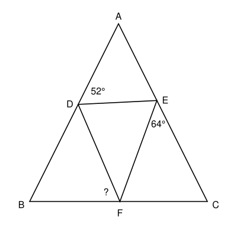

## Statement

Le triangle $ABC$ est isocèle en $A$ : les côtés $[AB]$ et $[AC]$ ont la même longueur. Les
points $D$, $E$ et $F$ sont sur les côtés $[AB]$, $[AC]$ et $[BC]$, et le triangle $DEF$ est
équilatéral.

On sait que $\widehat{ADE} = 52^\circ$ et $\widehat{CEF} = 64^\circ$. Que vaut l'angle
$\widehat{BFD}$ ?

La figure n'est pas exacte : les angles ne peuvent pas être mesurés dessus.

## Hints

1. Combien mesurent les angles d'un triangle équilatéral ?
2. Les points $A$, $E$ et $C$ sont alignés. Que vaut la somme
   $\widehat{AED} + \widehat{DEF} + \widehat{FEC}$ ?
3. Trouve l'angle $\widehat{BAC}$ dans le triangle $ADE$, puis les angles $\widehat{ABC}$ et
   $\widehat{ACB}$. Il ne reste plus qu'à regarder le triangle $BDF$.

## Solution

Le triangle $DEF$ est équilatéral, donc ses trois angles mesurent $60^\circ$.

**L'angle $\widehat{AED}$.** Les points $A$, $E$ et $C$ sont alignés, donc les trois angles
$\widehat{AED}$, $\widehat{DEF}$ et $\widehat{FEC}$ forment un angle plat :

$$\widehat{AED} = 180^\circ - 60^\circ - 64^\circ = 56^\circ.$$

**L'angle en $A$.** Dans le triangle $ADE$, la somme des angles vaut $180^\circ$ :

$$\widehat{BAC} = \widehat{DAE} = 180^\circ - 52^\circ - 56^\circ = 72^\circ.$$

**Les angles en $B$ et en $C$.** Le triangle $ABC$ est isocèle en $A$, donc
$\widehat{ABC} = \widehat{ACB}$. Comme leur somme vaut $180^\circ - 72^\circ = 108^\circ$, chacun
mesure $54^\circ$.

**L'angle $\widehat{BDF}$.** Les points $A$, $D$ et $B$ sont alignés, donc de même

$$\widehat{BDF} = 180^\circ - \widehat{ADE} - \widehat{EDF} = 180^\circ - 52^\circ - 60^\circ = 68^\circ.$$

**L'angle cherché.** Dans le triangle $BDF$,

$$\widehat{BFD} = 180^\circ - \widehat{DBF} - \widehat{BDF} = 180^\circ - 54^\circ - 68^\circ = 58^\circ.$$

**On vérifie.** Dans le triangle $CEF$, on trouve
$\widehat{EFC} = 180^\circ - 54^\circ - 64^\circ = 62^\circ$. Les trois angles en $F$ le long de
$[BC]$ font bien $58^\circ + 60^\circ + 62^\circ = 180^\circ$.

**L'angle $\widehat{BFD}$ mesure $58^\circ$.**
