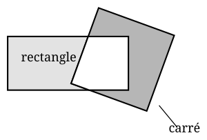

## Statement

On pose un rectangle de $4$ cm sur $9$ cm par-dessus un carré de côté $6$ cm, dans une position quelconque, comme sur la figure.

Deux morceaux sont grisés : le morceau du rectangle qui sort du carré, et le morceau du carré qui n'est pas recouvert par le rectangle.

Comparer les aires de ces deux morceaux grisés.

## Hints

1. Calcule l'aire du carré, puis l'aire du rectangle. Que remarques-tu ?
2. Appelle $c$ l'aire de la partie commune aux deux figures, celle qui est restée blanche. Surtout, ne cherche pas à la calculer : tu n'en as pas besoin.
3. Écris l'aire de chacun des deux morceaux grisés sous la forme d'une soustraction faisant intervenir $c$.

## Solution

**L'idée : ne pas calculer la partie commune.**

La partie blanche a une forme compliquée, qui change dès qu'on bouge le rectangle. On va donc s'arranger pour ne jamais avoir à la calculer.

**Étape 1. Les deux figures ont la même aire.**

$$\text{aire du carré} = 6 \times 6 = 36 \ \text{cm}^2$$
$$\text{aire du rectangle} = 4 \times 9 = 36 \ \text{cm}^2$$

Les deux aires sont égales, elles valent $36$ cm² toutes les deux.

**Étape 2. Enlever la partie commune.**

Notons $c$ l'aire de la partie commune, celle qui est restée blanche sur la figure.

Le carré est fait de deux morceaux : la partie commune, et le morceau grisé du carré. Donc

$$\text{aire du morceau grisé du carré} = 36 - c$$

Le rectangle est lui aussi fait de deux morceaux : la même partie commune, et le morceau grisé du rectangle. Donc

$$\text{aire du morceau grisé du rectangle} = 36 - c$$

**Conclusion.**

Les deux morceaux grisés ont la même aire, quelle que soit la position du rectangle sur le carré.

*Ce qu'il faut retenir.* Quand deux figures ont la même aire et qu'on leur enlève à toutes les deux la même partie, ce qui reste a encore la même aire. Il n'y avait donc rien à calculer du côté de la partie commune.

## Going further

1. On tourne ou on déplace le rectangle. Les deux morceaux grisés changent de forme, mais que peut-on encore dire de leurs aires ?
2. On remplace le rectangle par un rectangle de $4$ cm sur $10$ cm. Lequel des deux morceaux grisés est maintenant le plus grand, et de combien ?
3. Le carré mesure toujours $6$ cm de côté. Quelles dimensions peut avoir un rectangle pour que les deux morceaux grisés aient toujours la même aire ?
