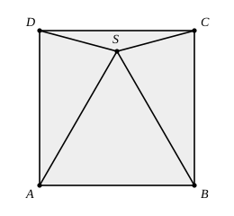

## Statement

Soit $ABCD$ un carré et soit $S$ un point à l'intérieur du carré tel que le triangle $ABS$ soit équilatéral. Déterminer l'angle $\widehat{DSC}$.

## Hints

1. Le triangle $ABS$ est équilatéral, donc $SA = SB = AB$. Et $AB$ est un côté du carré : que peux-tu dire de $SA$ et du côté $[AD]$ ?
2. Le triangle $ADS$ est donc isocèle. Calcule d'abord son angle en $A$, puis ses deux angles à la base.
3. Autour du point $S$, les quatre angles $\widehat{ASB}$, $\widehat{BSC}$, $\widehat{CSD}$ et $\widehat{DSA}$ font un tour complet.

## Solution

Notons $c$ la longueur du côté du carré. Le triangle $ABS$ est équilatéral de côté $AB = c$, donc

$$SA = SB = c \qquad \text{et} \qquad \widehat{SAB} = \widehat{SBA} = \widehat{ASB} = 60°.$$

**Le triangle $ADS$.** Le côté $[AD]$ du carré mesure aussi $c$, donc $AD = AS = c$ : le triangle $ADS$ est isocèle de sommet principal $A$. Son angle en $A$ vaut

$$\widehat{DAS} = \widehat{DAB} - \widehat{SAB} = 90° - 60° = 30°,$$

car la demi-droite $[AS)$ est à l'intérieur de l'angle $\widehat{DAB}$ ($S$ est à l'intérieur du carré). Les deux angles à la base sont donc égaux à

$$\widehat{ADS} = \widehat{ASD} = \frac{180° - 30°}{2} = 75°.$$

**Le triangle $BCS$.** Exactement de la même façon, $BC = BS = c$, l'angle $\widehat{SBC} = 90° - 60° = 30°$, donc

$$\widehat{BSC} = 75°.$$

**Le tour complet autour de $S$.** Le point $S$ est à l'intérieur du carré $ABCD$, donc les quatre demi-droites $[SA)$, $[SB)$, $[SC)$, $[SD)$ se succèdent autour de $S$ et les quatre angles font un tour complet :

$$\widehat{ASB} + \widehat{BSC} + \widehat{CSD} + \widehat{DSA} = 360°.$$

D'où

$$\widehat{DSC} = 360° - 60° - 75° - 75° = 150°.$$

**L'angle $\widehat{DSC}$ mesure $150°$.**

## Going further

On peut vérifier autrement : le triangle $DSC$ est isocèle en $S$ (car $SD = SC$ par symétrie de la figure par rapport à la médiatrice de $[AB]$), donc ses angles à la base valent $\frac{180° - 150°}{2} = 15°$ chacun. On retrouve bien $\widehat{SDC} = \widehat{ADC} - \widehat{ADS} = 90° - 75° = 15°$.
