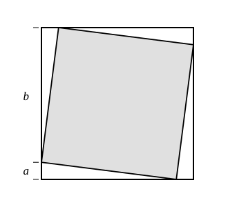

## Statement

Un carré d'aire $4$ est inscrit dans un carré d'aire $5$ : chacun de ses quatre sommets est posé sur un côté du grand carré, comme sur la figure.

Un sommet du petit carré partage le côté du grand carré sur lequel il se trouve en deux segments, de longueurs $a$ et $b$.

Quelle est la valeur de $a \times b$ ?

## Hints

1. Ne cherche pas à calculer $a$ et $b$ séparément : la question ne demande que leur produit.
2. Regarde la figure : le grand carré est découpé en cinq morceaux qui ne se chevauchent pas. Lesquels ?
3. Les quatre morceaux qui ne sont pas le petit carré sont des triangles rectangles. Quels sont les deux côtés de l'angle droit de l'un d'eux ?
4. Écris que l'aire du grand carré est la somme des aires des cinq morceaux.

## Solution

**On découpe le grand carré.**

Le petit carré et les quatre triangles des coins recouvrent exactement le grand carré, sans se chevaucher et sans rien laisser de côté. L'aire du grand carré est donc la somme de ces cinq aires.

**Les quatre triangles sont identiques.**

Regardons le triangle du coin en bas à gauche. Son angle droit est un coin du grand carré, et ses deux côtés de l'angle droit sont portés par deux côtés du grand carré. Sur l'un, il occupe le morceau de longueur $a$ ; sur l'autre, le morceau de longueur $b$, car les quatre sommets du petit carré partagent les côtés toujours dans le même sens quand on tourne autour de la figure : chaque coin reçoit donc un morceau court et un morceau long.

L'aire de ce triangle vaut

$$\frac{a \times b}{2} ,$$

et il en va de même pour les trois autres.

**On conclut.**

$$\underbrace{5}_{\text{grand carré}} = \underbrace{4}_{\text{petit carré}} + 4 \times \frac{a \times b}{2} = 4 + 2 \times (a \times b) .$$

Donc

$$2 \times (a \times b) = 1 , \qquad \text{c'est-à-dire} \qquad a \times b = \frac{1}{2} .$$

Remarquons qu'on n'a eu besoin ni de $a$, ni de $b$, ni d'aucune racine carrée.

## Going further

1. Le côté du petit carré est l'hypoténuse d'un de ces triangles. Que donne le théorème de Pythagore ? Retrouver que $a^2 + b^2 = 4$.
2. Le côté du grand carré vaut $a + b$, et son aire $5$. En déduire la valeur de $a + b$, puis, avec la question précédente, vérifier que $a \times b = \dfrac{1}{2}$ par un autre chemin.
