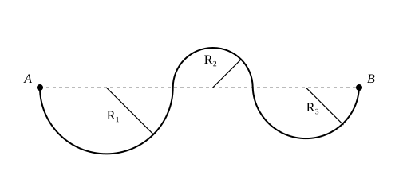

## Statement

Un ballon de diamètre $4$ part du point $A$ et suit le trajet dessiné ci-dessous. Ce trajet est formé de trois demi-cercles, de rayons $R_1 = 100$, $R_2 = 60$ et $R_3 = 80$ : un creux, puis une bosse, puis un creux.

Le ballon est posé sur le trajet, il reste toujours en contact avec lui et il ne glisse pas (il se déplace par rotation).

Quelle est la distance parcourue par le centre du ballon pendant le déplacement de $A$ à $B$ ?

## Hints

1. Le ballon a un diamètre de $4$, donc un rayon de $2$. À quelle distance du trajet se trouve son centre ?
2. Tant que le ballon roule sur un même demi-cercle, son centre reste à distance constante du centre de ce demi-cercle : le centre du ballon décrit lui aussi un demi-cercle, de même centre.
3. Attention : dans un creux, le ballon est du côté intérieur de l'arc ; sur une bosse, il est du côté extérieur. Le rayon décrit par son centre n'est donc pas le même dans les deux cas.
4. Un demi-cercle de rayon $r$ a pour longueur $\pi r$. Additionne les trois rayons avant de multiplier par $\pi$.

## Solution

**Où se trouve le centre du ballon.**

Le ballon a un diamètre de $4$, donc un rayon de $2$. Son centre est toujours à la distance $2$ du point de contact, sur la perpendiculaire au trajet, du côté où se trouve le ballon.

**Le centre décrit lui aussi des demi-cercles.**

Prenons le premier demi-cercle, le creux de rayon $R_1 = 100$. Le ballon est posé dans le creux, donc du côté du centre de cet arc. La distance qui sépare le centre du ballon du centre de l'arc vaut donc

$$100 - 2 = 98 ,$$

et cette distance ne change pas pendant tout le parcours de l'arc : le centre du ballon décrit un demi-cercle de rayon $98$.

Sur la bosse, de rayon $R_2 = 60$, c'est l'inverse : le ballon est posé **par-dessus** l'arc, donc à l'extérieur. Le centre du ballon décrit un demi-cercle de rayon

$$60 + 2 = 62 .$$

Sur le troisième demi-cercle, de rayon $R_3 = 80$, on est de nouveau dans un creux, donc le rayon vaut

$$80 - 2 = 78 .$$

**On additionne.**

Un demi-cercle de rayon $r$ a pour longueur $\pi r$. La distance parcourue par le centre vaut donc

$$\pi \times 98 + \pi \times 62 + \pi \times 78 = \pi \times (98 + 62 + 78) = 238\pi .$$

**On conclut.**

Le centre du ballon parcourt $238\pi$, c'est-à-dire environ $748$.

Remarquons que le trajet lui-même mesure $\pi \times (100 + 60 + 80) = 240\pi$ : le centre parcourt un peu moins, parce qu'il y a deux creux et une seule bosse.
