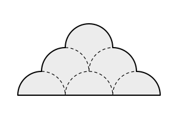
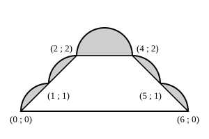

## Statement

Six demi-cercles de rayon $1$ sont disposés comme sur la figure :

- trois sont posés côte à côte sur une droite, leurs diamètres mis bout à bout ;
- deux autres ont pour diamètre le segment qui joint les sommets de deux demi-cercles voisins de la rangée du bas ;
- le sixième a pour diamètre le segment qui joint les sommets des deux précédents.

Ces six demi-cercles, et les trois diamètres posés sur la droite, délimitent le domaine grisé. Les arcs en pointillés sont à l'intérieur du domaine.

Quelle est l'aire de ce domaine ?

## Hints

1. Prends le rayon comme unité de longueur : chaque diamètre vaut alors $2$, et la droite du bas porte une longueur de $6$.
2. Place un repère dont l'origine est l'extrémité gauche de la droite du bas. Repère les six points où le bord extérieur du domaine passe d'un arc au suivant, et écris leurs coordonnées.
3. Joins ces six points par des segments : tu obtiens un hexagone. Le domaine, c'est cet hexagone plus les cinq bosses que les arcs ajoutent par-dessus.
4. L'hexagone se découpe en deux trapèzes : l'un entre les hauteurs $0$ et $1$, l'autre entre les hauteurs $1$ et $2$.
5. Quatre des cinq bosses sont identiques : chacune est un quart de disque auquel on a retiré un triangle rectangle. La cinquième, tout en haut, est un demi-disque entier.

## Solution

**On place un repère.**

Prenons le rayon comme unité. Chaque diamètre vaut $2$, donc la droite du bas porte une longueur de $3 \times 2 = 6$.

Plaçons l'origine à l'extrémité gauche de cette droite. Les centres des trois demi-cercles du bas sont alors en $(1 ; 0)$, $(3 ; 0)$ et $(5 ; 0)$, et leurs sommets en $(1 ; 1)$, $(3 ; 1)$ et $(5 ; 1)$.

Les deux demi-cercles du milieu ont pour diamètres $[(1 ; 1) ; (3 ; 1)]$ et $[(3 ; 1) ; (5 ; 1)]$ : leurs centres sont en $(2 ; 1)$ et $(4 ; 1)$, et leurs sommets en $(2 ; 2)$ et $(4 ; 2)$. Enfin le demi-cercle du haut a pour centre $(3 ; 2)$ et pour sommet $(3 ; 3)$.

**On suit le bord extérieur.**

En partant de $(0 ; 0)$ et en montant vers la gauche du dessin, le bord du domaine est fait de :

1. la moitié gauche du demi-cercle du bas à gauche, de $(0 ; 0)$ à $(1 ; 1)$ : un quart de cercle ;
2. la moitié gauche du demi-cercle du milieu à gauche, de $(1 ; 1)$ à $(2 ; 2)$ : un quart de cercle ;
3. le demi-cercle du haut tout entier, de $(2 ; 2)$ à $(4 ; 2)$ ;
4. la moitié droite du demi-cercle du milieu à droite, de $(4 ; 2)$ à $(5 ; 1)$ ;
5. la moitié droite du demi-cercle du bas à droite, de $(5 ; 1)$ à $(6 ; 0)$ ;

puis le retour par la droite du bas, de $(6 ; 0)$ à $(0 ; 0)$.

**On découpe le domaine.**

Joignons par des segments les six points où le bord change d'arc. On obtient un hexagone, et le domaine est cet hexagone auquel s'ajoutent cinq bosses.

**L'aire de l'hexagone.**

L'hexagone se coupe en deux trapèzes par la droite horizontale de hauteur $1$ :

- entre les hauteurs $0$ et $1$ : un trapèze de bases $6$ (en bas) et $4$ (en haut, de $x = 1$ à $x = 5$) et de hauteur $1$, d'aire $\dfrac{(6+4) \times 1}{2} = 5$ ;
- entre les hauteurs $1$ et $2$ : un trapèze de bases $4$ et $2$ et de hauteur $1$, d'aire $\dfrac{(4+2) \times 1}{2} = 3$.

L'hexagone a donc pour aire $5 + 3 = 8$.

**L'aire des cinq bosses.**

La bosse du haut est le demi-disque de rayon $1$ posé sur le segment qui joint $(2 ; 2)$ à $(4 ; 2)$. Son aire vaut $\dfrac{\pi \times 1^2}{2} = \dfrac{\pi}{2}$.

Les quatre autres bosses sont toutes du même modèle. Prenons celle du bas à gauche, entre le segment qui joint $(0 ; 0)$ à $(1 ; 1)$ et le quart de cercle de centre $(1 ; 0)$. Ajoutons les deux rayons qui vont de $(1 ; 0)$ à $(0 ; 0)$ et de $(1 ; 0)$ à $(1 ; 1)$ : ils forment un angle droit, et la bosse est le quart de disque privé de ce triangle rectangle :

$$\frac{\pi \times 1^2}{4} - \frac{1 \times 1}{2} = \frac{\pi}{4} - \frac{1}{2} .$$

**On conclut.**

$$\text{aire} = 8 + \frac{\pi}{2} + 4 \times \left(\frac{\pi}{4} - \frac{1}{2}\right) = 8 + \frac{\pi}{2} + \pi - 2 = 6 + \frac{3\pi}{2} .$$

L'aire du domaine vaut $6 + \dfrac{3\pi}{2} \approx \text{10,7}$.
