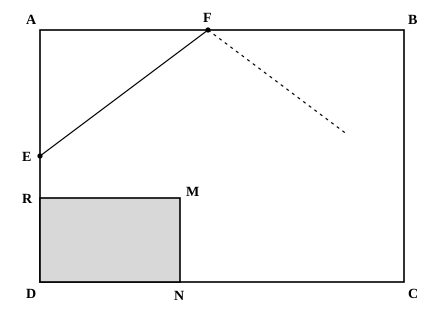
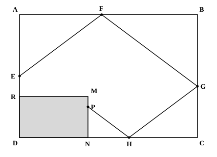

## Statement

Un escargot se promène dans un jardin de forme rectangulaire entouré d'un mur. Une maisonnette en occupe un coin. Sur le schéma ci-dessous, le rectangle $ABCD$ représente le jardin et le rectangle $RMND$ la maisonnette.

L'unité de longueur est le mètre. On donne

$$AB = 13 \qquad BC = 9 \qquad MN = 3 \qquad DN = 5$$

Soit $E$ le point de $[AD]$ tel que $AE = \text{4,5}$. L'escargot part du point $E$ et se déplace en ligne droite. Il atteint le mur en $F$, point de $[AB]$ tel que $EF = \text{7,5}$. Il poursuit son chemin comme si sa trajectoire se réfléchissait sur l'obstacle : à chaque rebond, l'angle d'arrivée et l'angle de départ ont la même mesure. Il rebondit de même sur $[BC]$ en un point $G$, puis sur $[NC]$ en un point $H$, avant d'atteindre $[MN]$ en un point $P$.

1. Compléter la figure et coder les angles de même mesure.
2. Déterminer la distance $PN$.
3. Les points $H$, $P$ et $E$ sont-ils alignés ?

## Hints

1. Commence par le premier segment. Le triangle $AEF$ est rectangle en $A$, et tu connais deux de ses côtés : que vaut $AF$ ?
2. Tu devrais trouver que l'escargot avance de $6$ m vers la droite pendant qu'il monte de $\text{4,5}$ m. Simplifie ce rapport : pour $4$ m parcourus vers la droite, de combien monte-t-il ?
3. Un rebond sur un mur horizontal change « monter » en « descendre » et ne change rien au déplacement horizontal. Un rebond sur un mur vertical change « vers la droite » en « vers la gauche » et ne change rien au déplacement vertical. La pente $\frac{3}{4}$, elle, ne change jamais.
4. Suis le trajet segment par segment. À chaque fois, une des deux distances (horizontale ou verticale) est connue, et la règle « $4$ en horizontal pour $3$ en vertical » donne l'autre.
5. Pour la question 3, remarque que $P$ est juste au-dessus de $N$, et que $E$ est juste au-dessus de $D$. Regarde les triangles $HNP$ et $HDE$, et utilise la réciproque du théorème de Thalès.

## Solution

Plaçons-nous dans le jardin : $A$ en haut à gauche, $B$ en haut à droite, $C$ en bas à droite, $D$ en bas à gauche. Le jardin mesure $13$ m de large et $9$ m de haut, et la maisonnette occupe le coin en bas à gauche, sur $5$ m de large ($DN = 5$) et $3$ m de haut ($MN = 3$).

### Le premier segment donne la pente du trajet

Le triangle $AEF$ est rectangle en $A$, avec $AE = \text{4,5}$ et $EF = \text{7,5}$. Le théorème de Pythagore donne

$$AF^2 = EF^2 - AE^2 = \text{7,5}^2 - \text{4,5}^2 = \text{56,25} - \text{20,25} = 36$$

donc $AF = 6$.

En allant de $E$ à $F$, l'escargot avance donc de $6$ m horizontalement pendant qu'il monte de $\text{4,5}$ m. Simplifions ce rapport :

$$\frac{\text{4,5}}{6} = \frac{3}{4}$$

**Pour $4$ m parcourus horizontalement, l'escargot se déplace de $3$ m verticalement.** C'est la seule chose à retenir, car les rebonds ne la changent pas : un rebond sur un mur horizontal échange « monter » et « descendre », un rebond sur un mur vertical échange « vers la droite » et « vers la gauche », mais le rapport $\frac{3}{4}$ reste le même sur tous les segments du trajet.

### On suit le trajet

**De $F$ à $G$.** Après le rebond en $F$, l'escargot continue vers la droite mais descend. Le point $F$ est à $6$ m de $A$, il reste donc $13 - 6 = 7$ m à parcourir horizontalement jusqu'au mur $[BC]$. Pendant ce temps, l'escargot descend de

$$7 \times \frac{3}{4} = \text{5,25 m}$$

Comme il partait de la hauteur $9$ m, il atteint $[BC]$ à la hauteur $9 - \text{5,25} = \text{3,75}$ m. Donc $BG = \text{5,25}$ et $GC = \text{3,75}$ : le point $G$ est bien sur le côté $[BC]$.

**De $G$ à $H$.** Après le rebond sur le mur vertical, l'escargot descend toujours, mais vers la gauche. Il doit descendre de $\text{3,75}$ m pour atteindre le sol $[DC]$, ce qui lui prend, horizontalement,

$$\text{3,75} \times \frac{4}{3} = 5\text{ m}$$

Il touche donc le sol à $5$ m de $C$, c'est-à-dire à $13 - 5 = 8$ m de $D$. Comme $DN = 5$, le point $H$ est bien situé sur $[NC]$, à $3$ m de $N$.

**De $H$ à $P$.** Après le rebond sur le sol, l'escargot remonte vers la gauche. Le mur $[MN]$ de la maisonnette est à $3$ m de $H$, et pendant ces $3$ m l'escargot monte de

$$3 \times \frac{3}{4} = \text{2,25 m}$$

**Réponse à la question 2 :** $PN = \text{2,25}$ m. Comme $MN = 3$, on a bien $PN < MN$ : le point $P$ est effectivement sur le mur $[MN]$ de la maisonnette.

### Question 3 : l'alignement

Les points $P$ et $N$ sont sur la même verticale, ainsi que les points $E$ et $D$. Les droites $(NP)$ et $(DE)$ sont donc parallèles (toutes deux perpendiculaires au sol).

Regardons maintenant les deux triangles $HNP$ et $HDE$ :

$$HN = 8 - 5 = 3 \qquad HD = 8 \qquad NP = \text{2,25} \qquad DE = AD - AE = 9 - \text{4,5} = \text{4,5}$$

Si les points $H$, $P$ et $E$ étaient alignés, alors, $N$ appartenant à $[HD]$ et $(NP)$ étant parallèle à $(DE)$, le théorème de Thalès donnerait

$$\frac{HN}{HD} = \frac{NP}{DE}$$

Or

$$\frac{HN}{HD} = \frac{3}{8} = \text{0,375} \qquad \text{et} \qquad \frac{NP}{DE} = \frac{\text{2,25}}{\text{4,5}} = \frac{1}{2} = \text{0,5}$$

Ces deux rapports sont différents, donc l'égalité de Thalès est fausse.

**Réponse à la question 3 :** les points $H$, $P$ et $E$ **ne sont pas alignés**.

On peut le dire autrement : depuis $H$, la droite $(HP)$ monte de $3$ m pour $4$ m parcourus, alors que la droite $(HE)$ monte de $\text{4,5}$ m pour $8$ m parcourus, c'est-à-dire de $3$ m pour $\frac{16}{3} \approx \text{5,3}$ m. Les deux droites n'ont pas la même pente.

**Conclusion.** $PN = \text{2,25}$ m, et les points $H$, $P$ et $E$ ne sont pas alignés.

## Going further

Après le rebond en $P$, l'escargot repart vers la droite en montant, toujours avec la même pente. Où touche-t-il le mur suivant ? Finira-t-il par revenir en $E$ ?
