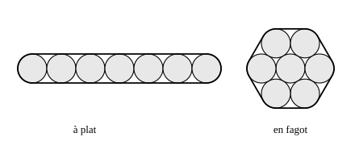

## Statement

On emballe sept tuyaux cylindriques de diamètre $20$ cm en les entourant de ruban adhésif. On peut les disposer à plat ou en fagot, comme le montrent les figures ci-dessous.

Quelle est, dans chacun des deux cas, la longueur d'un tour de ruban adhésif ?

## Hints

1. Vue de face, la situation est plane : chaque tuyau est un cercle de rayon $10$ cm, et le ruban tendu est une ligne fermée faite de morceaux droits et de morceaux courbes.
2. Deux tuyaux qui se touchent ont leurs centres à $20$ cm l'un de l'autre. Pourquoi ?
3. Un morceau droit du ruban est tangent à deux tuyaux voisins. Trace les deux rayons qui aboutissent aux points de contact : quelle figure vois-tu ? Que vaut alors la longueur du morceau droit ?
4. Occupe-toi ensuite des morceaux courbes. En faisant un tour complet, le ruban tourne en tout de $360°$, et il ne tourne que sur les morceaux courbes.
5. Si les morceaux courbes représentent au total un tour complet d'un cercle de rayon $10$ cm, leur longueur totale est facile à calculer.

## Solution

Vue de face, chaque tuyau est un cercle de rayon $r = 10$ cm, et le ruban tendu est une ligne fermée composée de **segments droits** (le ruban passe d'un tuyau au suivant) et d'**arcs de cercle** (le ruban épouse un tuyau).

Deux tuyaux qui se touchent ont leurs centres distants de $10 + 10 = 20$ cm.

**La longueur d'un morceau droit.**

Soit un segment de ruban tendu entre deux tuyaux voisins, de centres $O_1$ et $O_2$, et soient $T_1$ et $T_2$ ses points de contact. Les rayons $[O_1T_1]$ et $[O_2T_2]$ sont tous deux perpendiculaires au ruban, donc parallèles entre eux, et ils ont la même longueur $10$ cm. Le quadrilatère $O_1T_1T_2O_2$ a donc deux côtés opposés parallèles et de même longueur : c'est un parallélogramme, et même un rectangle puisqu'il a un angle droit. Par conséquent

$$T_1T_2 = O_1O_2$$

**Un morceau droit de ruban a exactement la longueur de la distance entre les deux centres.**

**La longueur totale des arcs.**

En parcourant le ruban une fois en entier, on revient à son point de départ dans la même direction : le ruban a donc tourné en tout de $360°$. Or il ne tourne pas sur les morceaux droits. **La somme des arcs correspond donc à un tour complet d'un cercle de rayon $10$ cm**, c'est-à-dire à une longueur de

$$2 \times \pi \times 10 = 20\pi\text{ cm} \approx \text{62,8}\text{ cm}$$

et ce, quelle que soit la disposition des tuyaux. Cette remarque va servir deux fois.

### Les tuyaux à plat

Les sept centres sont alignés et espacés de $20$ cm : du premier au dernier il y a

$$6 \times 20 = 120\text{ cm}$$

Le ruban comporte deux morceaux droits, l'un au-dessus et l'autre au-dessous, chacun de longueur $120$ cm, puis un demi-cercle à chaque bout. Les deux demi-tours font bien un tour complet, conformément à la remarque ci-dessus.

$$L_{\text{à plat}} = 2 \times 120 + 20\pi = 240 + 20\pi \approx \text{302,8}\text{ cm}$$

### Les tuyaux en fagot

Les six tuyaux extérieurs touchent chacun leurs deux voisins : leurs centres forment donc un **hexagone régulier de côté $20$ cm**. Le ruban comporte six morceaux droits, chacun de la longueur du côté correspondant, soit

$$6 \times 20 = 120\text{ cm}$$

puis six arcs. Vérifions la remarque sur ces six arcs : un angle intérieur d'un hexagone régulier mesure $120°$, donc à chaque sommet le ruban tourne de $180° - 120° = 60°$, et

$$6 \times 60° = 360°$$

Les six arcs forment bien un cercle complet, de longueur $20\pi$ cm.

$$L_{\text{en fagot}} = 120 + 20\pi \approx \text{182,8}\text{ cm}$$

**Conclusion.**

| disposition | longueur exacte | valeur approchée |
| --- | --- | --- |
| à plat | $240 + 20\pi$ cm | environ $\text{302,8}$ cm |
| en fagot | $120 + 20\pi$ cm | environ $\text{182,8}$ cm |

La partie courbe est la même dans les deux cas, un cercle entier. Toute la différence vient des parties droites : le fagot économise exactement $120$ cm de ruban, soit $\text{1,20}$ m.

## Going further

1. Quelle est la longueur du ruban pour $n$ tuyaux alignés à plat ?
2. On dispose maintenant six tuyaux en triangle : trois sur la rangée du bas, deux au-dessus, un au sommet. Quelle longueur de ruban faut-il ? Comparer avec le fagot de sept tuyaux.
