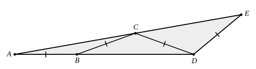

## Statement

$ADE$ est un triangle tel que $\widehat{ADE} = 140^\circ$. Le point $B$ est sur le côté $[AD]$
et le point $C$ est sur le côté $[AE]$, de façon que

$$AB = BC = CD = DE.$$

Calculer la mesure de l'angle $\widehat{EAD}$.

## Hints

1. Appelle $x$ la mesure cherchée, $x = \widehat{EAD}$, et exprime tous les autres angles en
   fonction de $x$, en avançant de proche en proche : d'abord le triangle $ABC$, puis $BCD$,
   puis $CDE$.
2. Chaque triangle de la chaîne est isocèle, car deux de ses côtés font partie de la liste
   $AB = BC = CD = DE$.
3. Dans un triangle, un angle extérieur est égal à la somme des deux angles intérieurs qui ne
   le touchent pas. C'est ce qui fait grandir l'angle à chaque étape.
4. Termine par la somme des angles du triangle $ADE$, dont tu connais l'angle en $D$.

## Solution

**L'idée : partir de l'angle cherché et remonter la chaîne de triangles isocèles. À chaque
étape l'angle augmente de $x$.**

Posons $x = \widehat{EAD} = \widehat{BAC}$.

**Étape 1. Le triangle $ABC$** est isocèle en $B$, car $AB = BC$. Ses angles à la base sont
égaux :

$$\widehat{BCA} = \widehat{BAC} = x.$$

L'angle $\widehat{CBD}$ est un angle extérieur du triangle $ABC$ en $B$ (le point $D$ est sur
la demi-droite $[AB)$, au-delà de $B$). Il vaut donc la somme des deux angles intérieurs non
adjacents :

$$\widehat{CBD} = \widehat{BAC} + \widehat{BCA} = 2x.$$

**Étape 2. Le triangle $BCD$** est isocèle en $C$, car $BC = CD$. Donc

$$\widehat{BDC} = \widehat{CBD} = 2x.$$

**Étape 3.** Comme $B$ est sur le côté $[AD]$, les demi-droites $[DB)$ et $[DA)$ sont les
mêmes, donc $\widehat{CDA} = \widehat{CDB} = 2x$.

L'angle $\widehat{DCE}$ est un angle extérieur du triangle $ACD$ en $C$ (le point $E$ est sur
la demi-droite $[AC)$, au-delà de $C$) :

$$\widehat{DCE} = \widehat{CAD} + \widehat{CDA} = x + 2x = 3x.$$

**Étape 4. Le triangle $CDE$** est isocèle en $D$, car $CD = DE$. Donc

$$\widehat{DEC} = \widehat{DCE} = 3x.$$

Comme $C$ est sur le côté $[AE]$, l'angle $\widehat{DEC}$ est l'angle $\widehat{DEA}$ du grand
triangle : $\widehat{DEA} = 3x$.

**Étape 5. Le triangle $ADE$.** Ses trois angles sont $x$ en $A$, $140^\circ$ en $D$ et $3x$
en $E$ :

$$x + 140^\circ + 3x = 180^\circ, \qquad 4x = 40^\circ, \qquad x = 10^\circ.$$

**Conclusion.** L'angle $\widehat{EAD}$ mesure $10^\circ$.

## Going further

Les angles rencontrés le long de la chaîne valent $x$, $2x$, $3x$, et l'angle augmente de $x$
à chaque nouveau segment. Avec $x = 10^\circ$, jusqu'où peut-on continuer à poser des segments
de même longueur ? On se servira de ceci : un triangle isocèle dont les angles à la base valent
$kx$ n'existe que si $kx < 90^\circ$.
